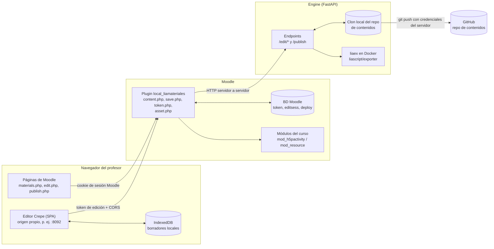
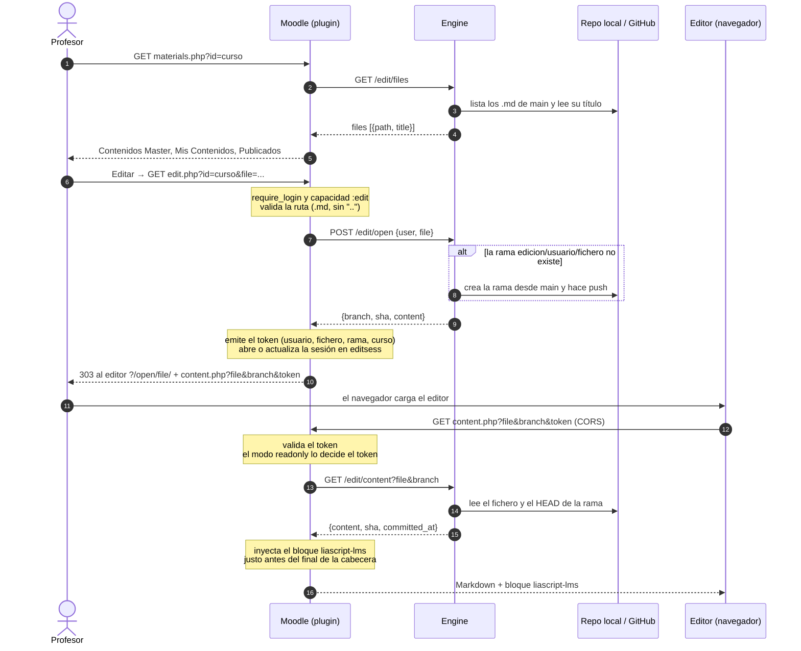
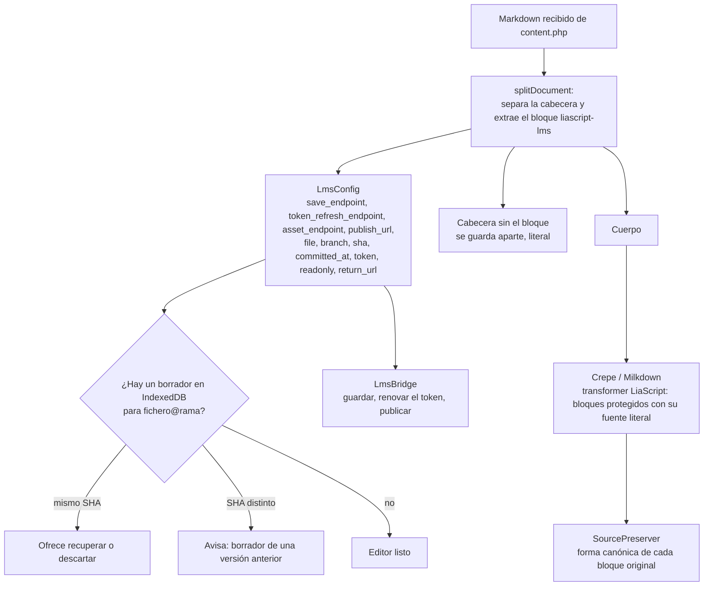
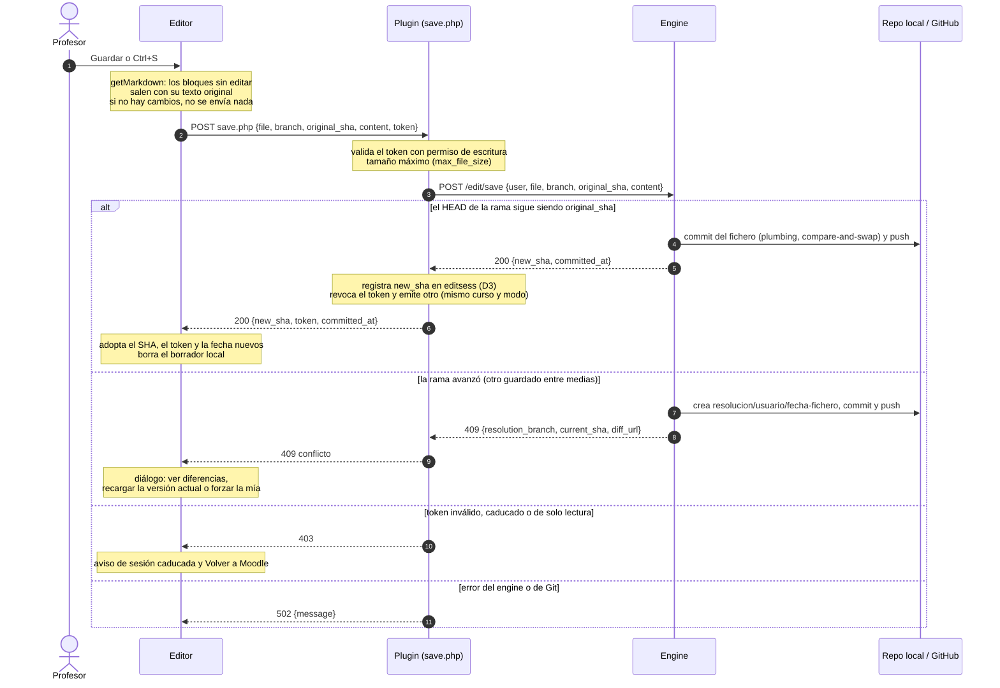
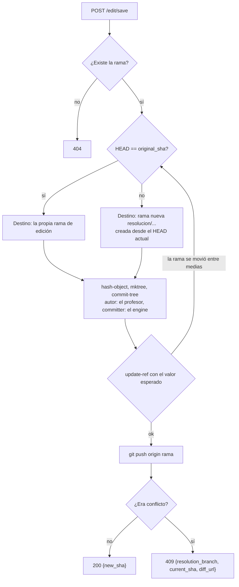
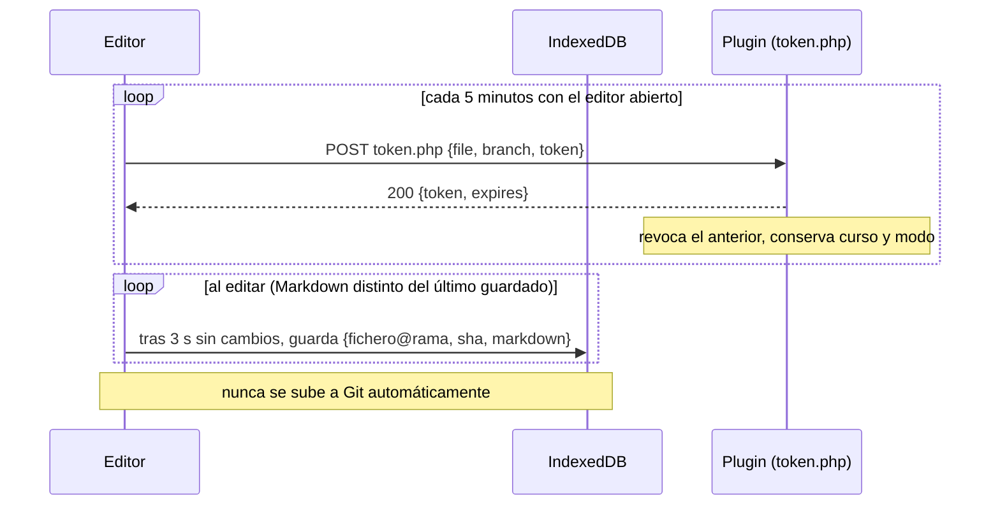
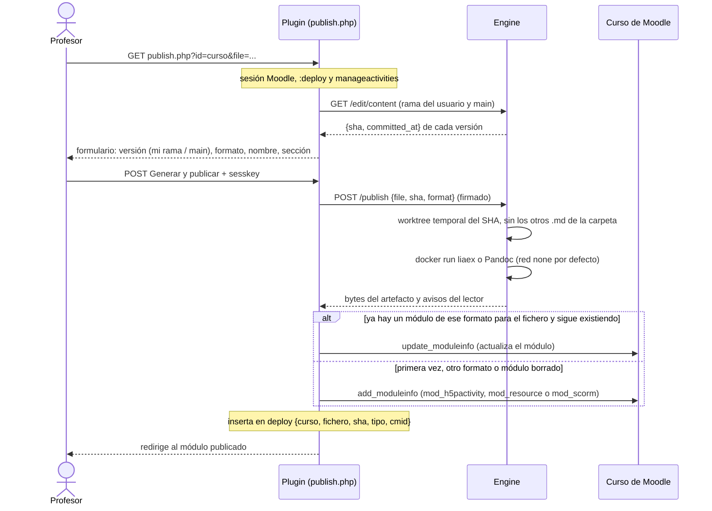

# Flujos de datos — plugin, engine y editor

Cómo colaboran los tres componentes de *Materiales Editables* en cada
operación del profesorado: **abrir un material para editarlo**,
**guardarlo** y **publicarlo** en el curso.

Estado descrito: plugin `local_liamateriales` 2.2.1 (2026112300), engine
`materiales_liascript-git` 2.0.0 y editor `fpvirtual-crepe-editor` (M1).

## 1. Componentes y canales

| Canal | Autenticación | Notas |
| --- | --- | --- |
| Páginas de Moodle → plugin | Sesión de Moodle (cookie) y capacidades `local/liamateriales:*` | `materials.php`, `edit.php`, `publish.php` |
| Editor → plugin | **Token** en el cuerpo o la URL (D9); CORS restringido al origen del editor | Las cookies de Moodle no viajan en un `fetch` entre orígenes |
| Plugin → engine | Ninguna hoy (red interna) | Pendiente: secreto compartido (ver §6) |
| Engine → GitHub | Credenciales del `origin` del clon (D1) | El profesorado no necesita cuenta de GitHub |

El **token** es una cadena aleatoria de 48 caracteres. En la BD solo se
guarda su `sha256`, ligado a usuario, fichero, rama, curso de origen y modo
(`readonly`). Caduca a los 15 minutos (ajuste `token_ttl`) y se renueva en
cada guardado y de forma periódica.

## 2. Abrir un material para editarlo

### 2.1 De la página de materiales al editor

### 2.2 Qué hace el editor con lo que recibe

### 2.3 Fecha de la versión (`committed_at`)

El engine añade a `/edit/content`, `/edit/open` y `/edit/save` la fecha del
commit (committer date, ISO 8601 con zona, como `git log -1 --format=%cI`).
El plugin la pasa al bloque `liascript-lms` (justo después de `sha`) y a la
respuesta 200 de `save.php` solo si tiene ese formato; si no, omite la clave.
El editor muestra «rama · versión del dd/mm/aaaa, hh:mm» en lugar del SHA.

### 2.4 Vista previa (solo lectura)

La página de materiales emite para cada material un **token de solo
lectura** (`readonly = 1`, sin curso) sobre `main`. `content.php` inyecta
`readonly: true` y el editor oculta Guardar y el enlace a Publicar. Aunque
se manipulara el editor, `save.php` rechaza ese token con 403. Ningún token
del editor sirve para publicar.

## 3. Guardar

### 3.1 Petición de guardado y respuestas

### 3.2 Decisión dentro del engine (`POST /edit/save`)

### 3.3 Salidas del conflicto (409)

| Opción del diálogo | Qué hace el editor |
| --- | --- |
| Ver diferencias | Abre `diff_url` (comparación en la forja) en otra pestaña |
| Recargar la versión actual | Vuelve a pedir `content.php` con el **token vigente** (el de la URL original ya está revocado) y descarta los cambios locales |
| Forzar mi versión | Repite el guardado con `original_sha = current_sha`; el contenido queda encima de la versión del servidor |

El trabajo del profesor no se pierde en ningún caso: el 409 ya lo dejó
commiteado en la rama `resolucion/...`.

### 3.4 Renovación del token y borrador local

## 4. Publicar

### 4.1 Desde el editor: enlace a la página Publicar

Publicar se hace **solo en la página Publicar del plugin**, con la sesión
de Moodle. El editor no publica: si el usuario puede publicar en el curso
(`:deploy`), `content.php` añade al bloque `liascript-lms` un
`publish_url` (`publish.php?id=<curso>&file=<material>`, sin token) y el
editor muestra un enlace «Publicar…» que la abre en otra pestaña. Con
cambios sin guardar, avisa en lugar de abrirla: la página usa la última
versión guardada. El editor solo acepta `publish_url` si es del mismo
origen que Moodle.

La publicación en un clic con el token del editor (`publish_api.php`) se
retiró en la versión 2.8.0 del plugin: duplicaba la página Publicar con
menos opciones y era un script sin sesión que creaba actividades.

### 4.1b Tema visual de los contenidos

Los contenidos los renderiza LiaScript, no el editor. Para que tengan el
mismo aspecto, el engine aplica al exportar la hoja del tema del editor
(`publish/themes/verde.css`, generada desde el editor con
`npm run theme:liascript`; `MATERIALES_LIASCRIPT_THEME`, defecto `verde`):

- SCORM, H5P y PDF: añade `link:` a la cabecera **en la copia temporal** y
  copia la hoja junto al material. liaex la empaqueta (SCORM), la incrusta
  en la cabecera (H5P) o la aplica al renderizar (PDF).
- ePub: liaex ignora `link:`; el engine añade la hoja a las hojas de estilo
  del ePub ya generado.

El material en Git no cambia.

### 4.2 Publicación desde la página Publicar del plugin

`publisher::publish_generated`, con sesión de Moodle. Una publicación a la
vez por usuario y material (bloqueo). El profesor elige la versión (la última de su
rama de edición, es decir, su HEAD, o la oficial de `main`), el formato
(H5P, ePub, PDF o SCORM 1.2), el nombre y la sección; el SHA lo resuelve
el servidor. «Descargar sin publicar» genera el mismo fichero y lo entrega
al navegador sin crear módulo ni registro.

Como alternativa plegada, se puede **subir un fichero generado por cuenta
propia** (por ejemplo con el LiaScript Exporter en el navegador); se
registra igual.

### 4.3 Estado de lo publicado

`materials.php` consulta, para cada despliegue registrado,
`GET /edit/state?file&sha` del engine. El engine compara el SHA publicado
con el HEAD de `main` y responde `up_to_date` o `update_available`, con el
número de commits de diferencia.

## 5. Dónde vive cada dato

| Dato | Dónde | Quién lo escribe |
| --- | --- | --- |
| Contenido del material | Git: `main`, `edicion/*`, `resolucion/*` | Engine (commit y push) |
| Token de edición (hash) | `local_liamateriales_token` | Plugin (`edit.php`, `materials.php`, `save.php`, `token.php`) |
| Sesión de edición y último SHA guardado | `local_liamateriales_editsess` | Plugin (`edit.php`, `save.php`) |
| Publicaciones (curso ↔ fichero ↔ SHA ↔ cmid) | `local_liamateriales_deploy` | Plugin (`publish.php`) |
| Artefacto publicado | Ficheros del módulo en Moodle | Plugin (`add_moduleinfo` / `update_moduleinfo`) |
| Borrador sin guardar | IndexedDB del navegador | Editor |
| Configuración LMS de la sesión | Memoria del editor (bloque `liascript-lms`) | Plugin la inyecta en cada apertura; nunca se guarda en Git |

## 6. Limitaciones conocidas de estos flujos

- **Plugin → engine sin autenticación**: cualquiera con acceso al puerto
  del engine puede llamar a `/edit/save` o `/publish`. Hay que añadir un
  secreto compartido y no publicar el puerto del engine.
- **El engine no hace `fetch`**: trabaja con las ramas locales del clon.
  Los cambios hechos directamente en GitHub no se ven hasta actualizar el
  clon, y un `push` rechazado deja el commit local hecho.
- **Publicación síncrona**: la petición espera a liaex (unos segundos;
  más en PDF). Con varios profesores a la vez convendría una cola.
- **Tokens en la URL de apertura**: el primer token viaja en la URL de
  `content.php` (registros de acceso e historial). Se revoca en el primer
  guardado o renovación.
