# Seguridad — Evaluación del plugin `local_liamateriales`

Documento para el equipo de seguridad. Describe la superficie expuesta, los
flujos de autenticación y de datos (diagramas de secuencia y de actividad),
los controles aplicados y los riesgos residuales conocidos.

| | |
| --- | --- |
| **Sistema** | Materiales Editables: plugin de Moodle `local_liamateriales`, engine `materiales_liascript-git` (Python/FastAPI) y editor web `fpvirtual-crepe-editor` |
| **Versión evaluada** | Plugin 2.6.0 (`2026112403`); rama `feature/seguridad` de `moodle-liascript-git` (commit `2c8be12`) y de `fpvirtual-crepe-editor` (commit `c957d56`) |
| **Moodle** | 5.3 o superior |
| **Entornos** | Producción: tres servidores (Moodle; base de datos; engine y editor), §2.2. Pruebas: todo en contenedores en un único host, §2.3 |
| **Fecha** | 2026-11-24 |
| **Estado** | Controles de la fase S implementados y probados con tests automáticos; pendiente el despliegue y las pruebas en el entorno de pruebas (§11) |

Los diagramas usan Mermaid; se ven en GitHub, en VS Code y en cualquier
visor de Markdown con Mermaid.

---

## 1. Qué hace el sistema

El profesorado edita materiales didácticos en Markdown (formato LiaScript)
guardados en un repositorio Git, desde un editor web, y los publica en sus
cursos de Moodle como H5P, SCORM 1.2, ePub, PDF o web estática.

- **Plugin** (`local_liamateriales`): catálogo de materiales del curso,
  apertura del editor, tokens, sesiones de edición, publicación como
  actividades de Moodle (`mod_resource`, `mod_h5pactivity`, `mod_scorm`),
  trazabilidad y auditoría.
- **Engine** (`materiales_liascript-git`): servicio interno que hace todo lo
  relativo a Git (ramas por usuario, commits, push, conflictos) y genera los
  ficheros de publicación lanzando contenedores Docker (liaex, Pandoc).
- **Editor** (`fpvirtual-crepe-editor`): aplicación estática (Vue) servida
  desde otro origen; habla con Moodle por `fetch` entre orígenes.

## 2. Arquitectura y fronteras de confianza

### 2.1 Componentes y fronteras

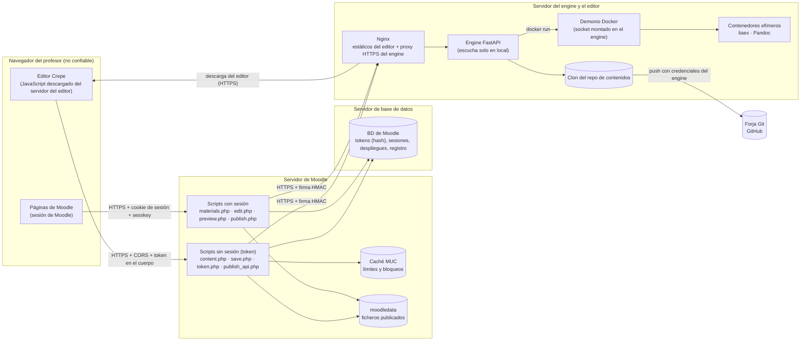

| Frontera | Qué la cruza | Control principal |
| --- | --- | --- |
| Navegador → scripts con sesión | Peticiones del profesor dentro de Moodle | Sesión de Moodle, `require_login`, capacidades, `sesskey` en los POST |
| Navegador (editor) → scripts sin sesión | `fetch` entre orígenes desde el editor | Token opaco ligado a usuario + fichero + rama; CORS limitado al origen del editor; límites de uso |
| Moodle → engine | Llamadas de servidor a servidor entre dos máquinas | HTTPS; cortafuegos que solo admite la IP de Moodle; firma HMAC-SHA256 con secreto compartido |
| Engine → Docker | Lanzamiento de contenedores de conversión | Imágenes fijas, red `none` por defecto, copia temporal del commit |
| Engine → forja | `git push` de las ramas de edición | Credenciales de escritura del engine (no las del usuario) |
| Engine → Moodle | **No existe.** El engine no tiene cliente HTTP ni credenciales de Moodle o de la BD | — |

**Por qué hay scripts sin sesión.** El editor se sirve desde otro origen y
la cookie de sesión de Moodle (SameSite=Lax) no viaja en sus `fetch`. Por
eso esos cuatro scripts se autentican con un token propio.

### 2.2 Topología de producción

- **Servidor A**: Moodle instalado de forma nativa (sin contenedores), única
  instancia en esa máquina.
- **Servidor B**: base de datos de Moodle; solo el servidor A tiene acceso.
- **Servidor C**: gestionado por el equipo del proyecto. Aloja el engine,
  Docker con los conversores y los estáticos del editor.

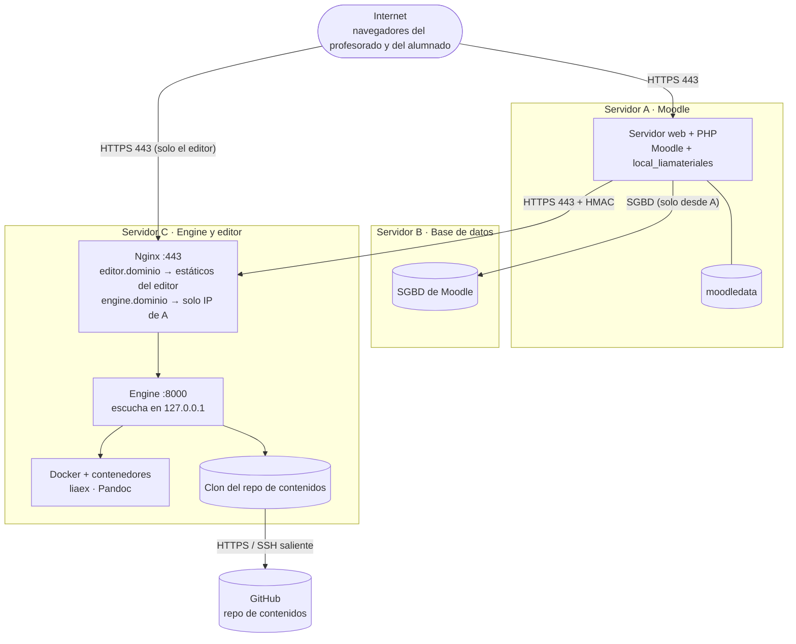

**Matriz de flujos de red.** Cualquier flujo que no aparezca aquí debe estar
denegado.

| # | Origen | Destino | Puerto | Protocolo | Motivo |
| --- | --- | --- | --- | --- | --- |
| F1 | Internet | A (Moodle) | 443 | HTTPS | Moodle; incluye los cuatro scripts que usa el editor |
| F2 | Internet | C (Nginx, nombre del editor) | 443 | HTTPS | Descarga de los estáticos del editor |
| F3 | A (Moodle) | B (BD) | Puerto del SGBD | Protocolo del SGBD (con TLS si es posible) | Base de datos de Moodle |
| F4 | A (Moodle) | C (Nginx, nombre del engine) | 443 | HTTPS + firma HMAC | Peticiones al engine (servidor a servidor) |
| F5 | C (engine) | GitHub | 443 o 22 | HTTPS o SSH | `fetch` y `push` del repositorio de contenidos |
| F6 | C (Docker) | Registro de imágenes | 443 | HTTPS | Solo al actualizar las imágenes de liaex y Pandoc |

**Flujos que no deben existir:**
- de Internet al puerto del engine (8000) o a cualquier ruta del engine en C;
- de C a A o a B;
- del navegador al engine;
- de cualquier origen distinto de A a la base de datos.

### 2.3 Entorno de pruebas (diferencias)

En pruebas (`192.168.2.253`), Moodle, su base de datos, el engine y el
editor corren en contenedores Docker en un mismo host, por HTTP y sin TLS.
Ahí el engine está en la red Docker de Moodle y comprometerlo daría control
sobre todo el host, Moodle incluido. Este documento evalúa la topología de
producción; el entorno de pruebas no debe usarse con datos reales (R11).

### 2.4 Alcance de un compromiso, por servidor

| Si se compromete… | Obtiene | No obtiene |
| --- | --- | --- |
| **Servidor A (Moodle)** | Todo Moodle: `config.php` (credenciales de la BD y secreto compartido), `moodledata`, sesiones. Con el secreto, puede llamar al engine: escribir en cualquier rama del repositorio de contenidos y lanzar conversiones | Root en C: las rutas del engine no aceptan argumentos libres para Docker |
| **Servidor B (BD)** | Datos de Moodle: hashes de tokens (no se pueden usar sin el token en claro), sesiones de edición, despliegues y registro. Si el secreto se guardó en el ajuste del plugin y no en `config.php`, también el secreto (R12) | El servidor A, el servidor C y el repositorio |
| **Engine** (ejecución de código en el proceso) | **Root en C** por el socket de Docker (R3): el repositorio y sus credenciales Git, el secreto compartido y **los ficheros del editor** (R13) | El servidor A y el B: el engine no tiene red ni credenciales hacia ellos |
| **Ficheros del editor** (en C) | El editor que ejecuta el navegador del profesorado: puede robar tokens de edición (15 min, un fichero y un curso), guardar contenido manipulado y publicar HTML o JavaScript en los cursos (R5) | Sesiones de Moodle: el editor no las recibe |

## 3. Actores y permisos

| Capacidad | Contexto | Por defecto | Permite |
| --- | --- | --- | --- |
| `local/liamateriales:viewcatalog` | Curso | teacher, editingteacher, manager | Ver el catálogo y abrir la vista previa (solo lectura) |
| `local/liamateriales:edit` | Curso | editingteacher, manager | Abrir un material para editarlo en su rama `edicion/<usuario>/<fichero>` |
| `local/liamateriales:editmain` | Curso | manager | Editar directamente la rama oficial `main` |
| `local/liamateriales:deploy` | Curso | editingteacher, manager | Publicar en el curso (junto con `moodle/course:manageactivities`) |

Las capacidades se comprueban al emitir el código de apertura y **otra
vez** al publicar (`publish_api.php` revisa `deploy` y
`moodle/course:manageactivities` en el momento de la petición).

## 4. Superficie expuesta

### 4.1 Scripts del plugin

| Script | Autenticación | Métodos | Uso |
| --- | --- | --- | --- |
| `materials.php` | Sesión + `viewcatalog` | GET | Catálogo de materiales del curso |
| `edit.php` | Sesión + `edit` (`editmain` para `main`) | GET | Abre el editor (crea o reutiliza la rama de edición) |
| `preview.php` | Sesión + `viewcatalog` | GET | Abre el editor en solo lectura sobre `main` |
| `publish.php` | Sesión + `deploy` + `manageactivities` + `sesskey` | GET, POST | Página Publicar (generar, descargar o subir y publicar) |
| `content.php` | Código de apertura o token de edición (cuerpo) | POST (GET solo en modo antiguo), OPTIONS | Entrega el Markdown al editor |
| `save.php` | Token de edición (cuerpo) | POST, OPTIONS | Guarda (commit y push) |
| `token.php` | Token de edición (cuerpo) | POST, OPTIONS | Renueva el token |
| `publish_api.php` | Token de edición (cuerpo) + capacidades | POST, OPTIONS | Publicación en un clic desde el editor |
| `asset.php` | Token de edición o de solo lectura (cuerpo) | POST, OPTIONS | Imágenes de la carpeta del material para el editor (PNG, JPEG, GIF, WebP) |

**Imágenes.** `save.php` acepta imágenes nuevas en el mismo guardado
(PNG, JPEG o GIF; 20 como máximo, 2 MB cada una y 10 MB en total). El
plugin valida la ruta, el base64 y el tipo real (`finfo`, `getimagesize`)
y el engine repite la validación (ruta dentro de la carpeta del material,
firma de bytes). SVG nunca (puede llevar JavaScript). `asset.php` solo
sirve tipos de una lista, con `nosniff`, `Content-Security-Policy:
default-src 'none'` y `sandbox`.

Los cinco scripts sin sesión responden siempre con
`Referrer-Policy: no-referrer`, `X-Content-Type-Options: nosniff`,
`Cache-Control: no-store` y `Access-Control-Allow-Origin` limitado al
origen del editor (`Vary: Origin`).

### 4.2 Engine (sin exposición pública)

En producción, el engine escucha en `127.0.0.1:8000` del servidor C. Nginx
lo publica por HTTPS con un nombre propio y solo admite la IP del servidor
de Moodle (`allow <IP de A>; deny all;`). El cortafuegos del servidor C
aplica la misma regla.

| Ruta | Uso |
| --- | --- |
| `GET /health` | Healthcheck (la única ruta sin firma) |
| `GET /edit/files`, `GET /edit/content`, `GET /edit/state` | Lectura del repositorio |
| `POST /edit/open`, `POST /edit/save` | Rama de edición; guardado con control de concurrencia por SHA |
| `POST /publish` | Genera el fichero de un commit concreto (contenedores Docker) |

### 4.3 Editor

Ficheros estáticos sin servidor propio. Guarda borradores del Markdown en
IndexedDB del navegador (§8, R7). Lleva `<meta name="referrer"
content="no-referrer">`; la CSP la aplica el servidor web (ejemplo en el
README del editor).

## 5. Credenciales y secretos

| Elemento | Formato | Vida | Dónde vive | Dónde viaja |
| --- | --- | --- | --- | --- |
| **Código de apertura** (`kind=open`) | 48 caracteres aleatorios | 60 s, un solo uso | BD: solo su SHA-256 | Fragmento de la URL del editor (`#open=…`), que no llega a ningún servidor; después, cuerpo de `POST content.php` |
| **Token de edición** (`kind=edit`) | 48 caracteres aleatorios | 15 min (ajustable), se renueva en cada guardado y cada 5 min | BD: solo su SHA-256; memoria del editor | Cuerpo de las peticiones; nunca en una URL |
| **Secreto compartido** plugin ↔ engine | Recomendado 32 bytes en hexadecimal | Hasta que se rote | `config.php` de Moodle (o ajuste del plugin) y variable de entorno del engine | No viaja: solo firma |
| **Credenciales Git** del engine | Token o clave de la forja | Gestión de la forja | Remoto `origin` del clon del engine | Solo engine → forja |

Los tokens van ligados a usuario, fichero, rama, curso de origen y modo
(solo lectura o escritura). Un token de solo lectura no sirve para guardar
ni para publicar. Un código de apertura no sirve como token de edición.

---

## 6. Diagramas de secuencia

### 6.1 Abrir un material para editarlo

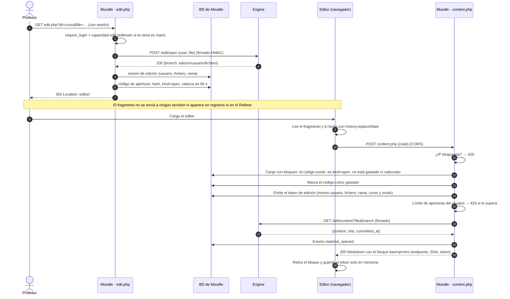

### 6.2 Vista previa (solo lectura)

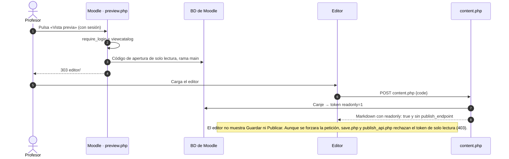

### 6.3 Guardar

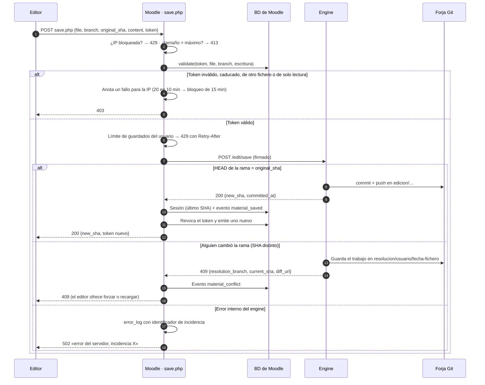

### 6.4 Renovar el token y recargar la versión del servidor

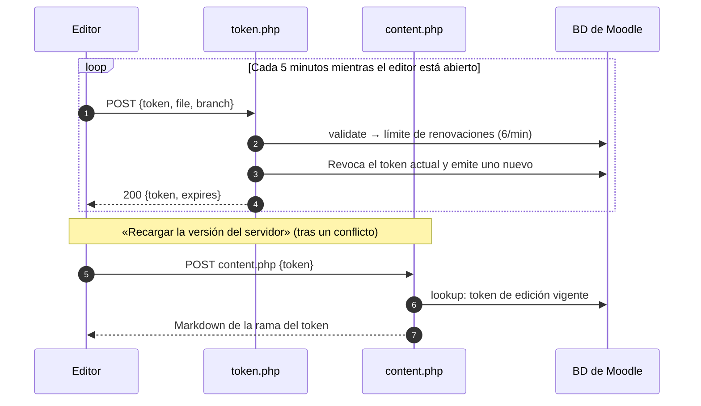

### 6.5 Publicar desde el editor

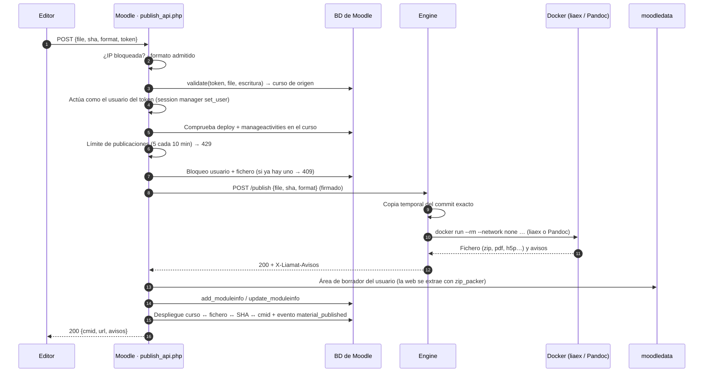

### 6.6 Publicar desde la página Publicar del plugin

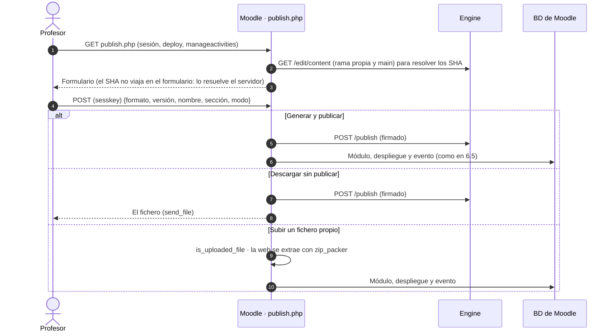

### 6.7 Firma de las peticiones al engine

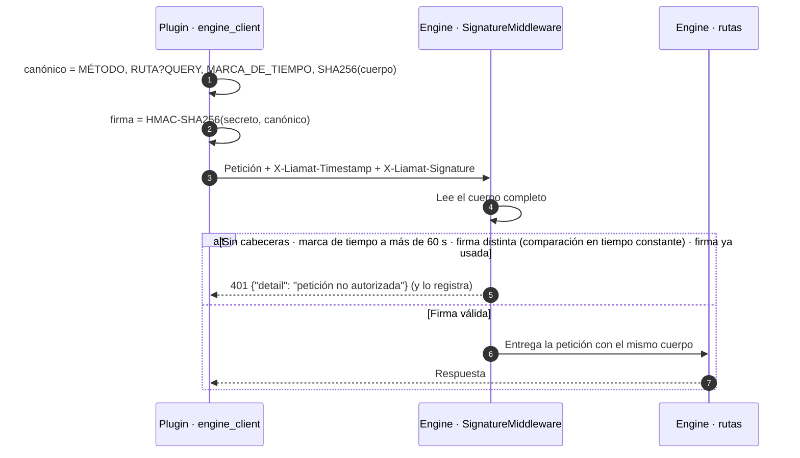

### 6.8 Abuso: barrido de tokens

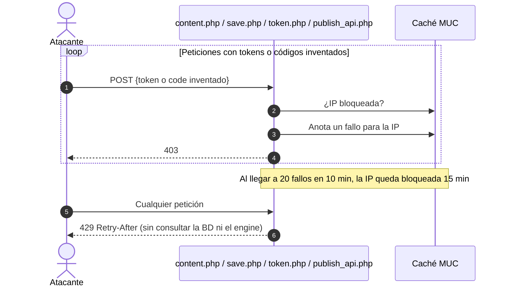

---

## 7. Diagramas de actividad

### 7.1 `content.php`

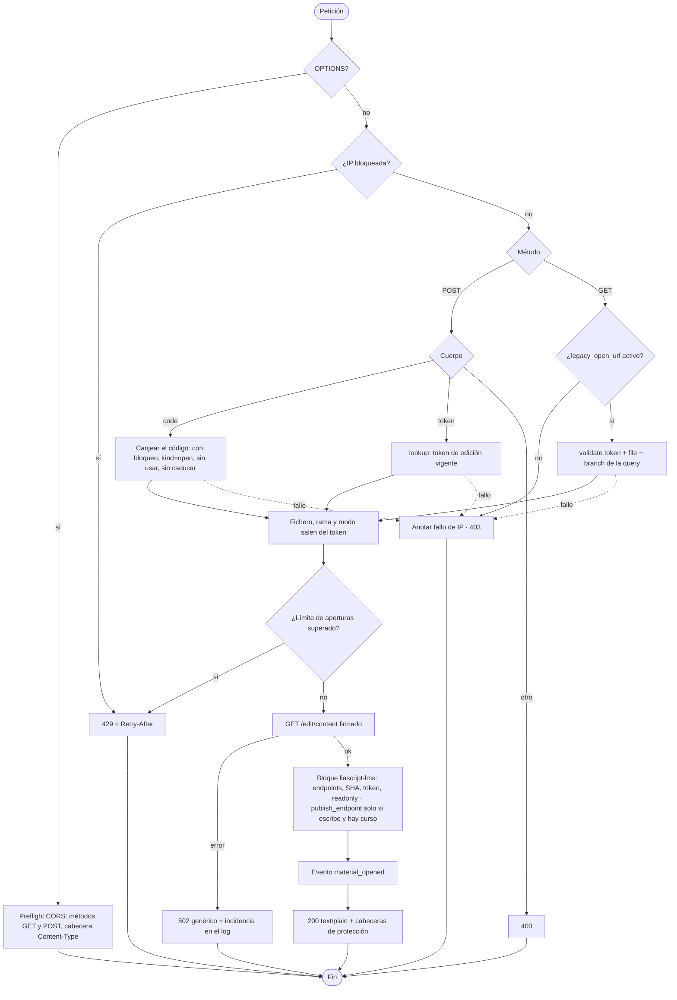

### 7.2 `save.php`

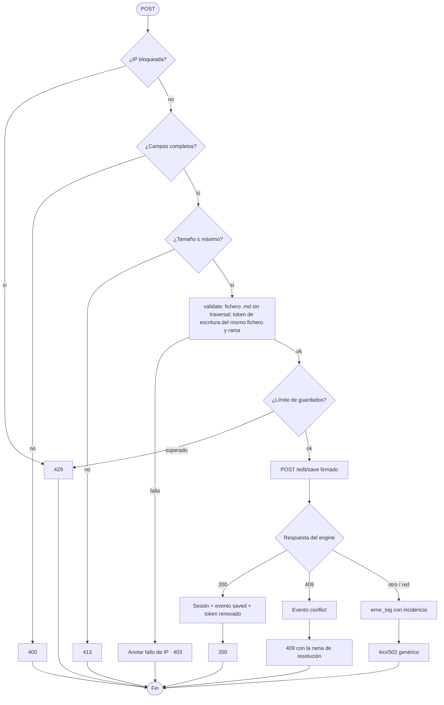

### 7.3 `publish_api.php`

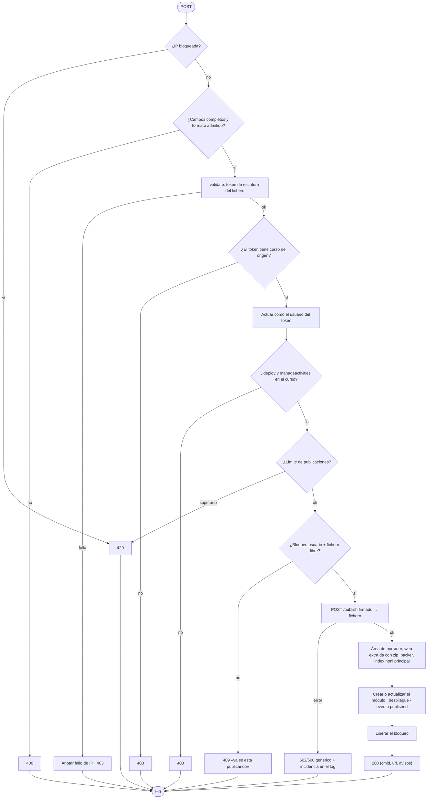

### 7.4 Canje del código de apertura (`token_manager::redeem`)

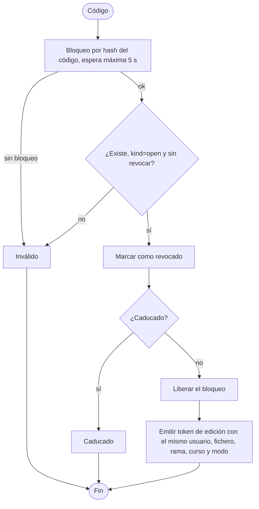

### 7.5 Middleware de firma del engine

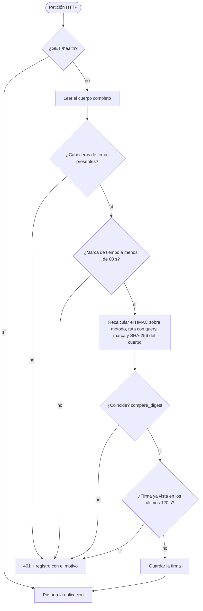

### 7.6 Tarea diaria de limpieza

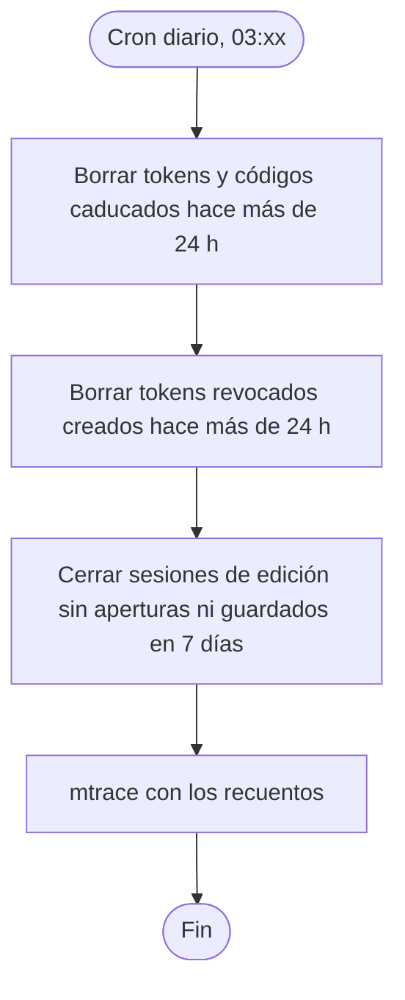

---

## 8. Datos tratados

| Dato | Dónde | Contenido | Retención |
| --- | --- | --- | --- |
| `local_liamateriales_token` | BD de Moodle | SHA-256 del token, userid, curso, fichero, rama, modo, clase, caducidad, revocado | Se borra 24 h después de caducar o revocarse (tarea diaria) |
| `local_liamateriales_editsess` | BD de Moodle | userid, fichero, rama, último SHA, fechas | Se cierra a los 7 días sin actividad; no se borra |
| `local_liamateriales_deploy` | BD de Moodle | Curso, fichero, SHA, formato, cmid, username de quien publica, fecha | Permanente (trazabilidad) |
| Registro de Moodle | `logstore_standard_log` | Eventos abierto, guardado, conflicto y publicado | Según la política del registro de Moodle |
| Caché `ratelimit` | MUC (aplicación) | Marcas de tiempo por usuario y acción; fallos y bloqueos por IP (hash SHA-1 de la IP) | Ventanas de 1 a 15 minutos |
| Repositorio de contenidos | Clon del engine y forja | Markdown de los materiales; autor de los commits (username) | Historial de Git |
| Ficheros publicados | moodledata | H5P, SCORM, ePub, PDF y web | Mientras exista el módulo |
| Borradores del editor | IndexedDB del navegador | Markdown sin el bloque LMS (sin token), SHA y fecha | Se borra al guardar o recargar; si no, queda en el navegador |
| Logs | PHP (`error_log`), engine (structlog) | Detalle de los errores con identificador de incidencia; rechazos de firma | Según la configuración del servidor |

---

## 9. Amenazas y controles

| # | Amenaza | Controles | Dónde |
| --- | --- | --- | --- |
| T1 | Llamadas directas al engine (commits en `main`, lanzar contenedores) | Engine accesible solo desde la IP de Moodle (cortafuegos + Nginx); firma HMAC obligatoria; el servicio no arranca sin secreto | `engine/…/auth.py`, `serve.py`, `classes/local/engine_client.php` |
| T2 | Robo del token en URLs, registros, historial o Referer | Código de un solo uso en el fragmento; token solo en el cuerpo; `Referrer-Policy: no-referrer`; `Cache-Control: no-store` | `content.php`, `lib.php`, editor `openUrl.ts` |
| T3 | Reutilización de un código o token capturado | Código de 60 s y un solo uso (canje con bloqueo); token de 15 min revocado en cada renovación; solo se guarda el hash | `classes/local/token_manager.php` |
| T4 | Escalada de modo (vista previa → escritura) o de fichero | El token fija fichero, rama, curso y modo; validación en cada script; capacidades revisadas al publicar | `token_manager::validate`, `publish_api.php` |
| T5 | Fuerza bruta o barrido de tokens | Tokens de 48 caracteres aleatorios; bloqueo por IP (20 fallos / 10 min → 15 min) | `classes/local/rate_limiter.php` |
| T6 | Abuso de recursos (bucles de guardado o publicación) | Límites por usuario (429); una publicación a la vez (409); límite en el proxy | `rate_limiter`, `publisher::publish_generated` |
| T7 | Filtración de información interna | Errores genéricos con identificador de incidencia; detalle solo en el log | `local_liamateriales_api_internal_error` |
| T8 | Path traversal en el fichero o en el zip | Validación de rutas en plugin y engine (relativa, `.md`, sin `..`); extracción con `zip_packer` de Moodle, que limpia rutas | `lib.php`, `edit/branches.py`, `publisher::stage_web` |
| T9 | CSRF en las páginas con sesión | `sesskey` en los POST de `publish.php`; los scripts del editor no usan la cookie | `publish.php` |
| T10 | Uso desde otro origen | CORS limitado al origen del editor | `local_liamateriales_api_headers` |
| T11 | Falta de trazabilidad | Eventos de Moodle y tabla de despliegues | `classes/event/*` |
| T13 | Imágenes maliciosas (SVG con JavaScript, HTML disfrazado, rutas fuera del material, tamaño) | Solo PNG/JPEG/GIF para subir; tipo real comprobado en plugin y engine; rutas normalizadas dentro de la carpeta del material; límites de número y tamaño; respuestas de `asset.php` con `nosniff`, CSP y `sandbox`; el editor recodifica (elimina EXIF) | `plugin/lib.php` (`local_liamateriales_validate_images`), `asset.php`, `engine/…/images.py` |
| T14 | Un paquete publicado (H5P, SCORM) lleva otros materiales de la misma carpeta, que el alumnado puede descargar | El engine exporta con liaex desde una copia del SHA sin los otros `.md` de la carpeta del material; convención de un material por carpeta | `engine/…/publish/service.py` (`isolate_material`) |
| T12 | Contenedores de conversión | Copia temporal del commit, `--rm`, red `none` por defecto (Pandoc además con `--user`) | `publish/service.py`, `publish/pandoc_export.py` |

---

## 10. Riesgos residuales y hallazgos abiertos

Se listan para que el equipo de seguridad decida su tratamiento.

| # | Hallazgo | Impacto | Propuesta |
| --- | --- | --- | --- |
| R1 | **Privacidad (RGPD)**: el plugin declara `null_provider`, pero guarda datos personales (userid en tokens y sesiones, username en despliegues). | Exportar o borrar datos de un usuario no incluye estas tablas. | Implementar el proveedor de privacidad (metadatos, exportación y borrado). **Prioridad alta.** |
| R2 | **El engine confía en el plugin para autorizar.** `/edit/save` admite cualquier rama existente, incluida `main`; la restricción (rama propia o `editmain`) la aplica el plugin al emitir el token. | Con el secreto, se podría escribir en `main`. | Mantener el secreto fuera de la BD (`config.php`) y rotarlo; opcionalmente, que el engine rechace `main` salvo con un indicador firmado. |
| R3 | **Socket de Docker en el engine.** El demonio de Docker corre como root y quien puede usar su socket puede crear un contenedor que monte el disco del host (`-v /:/host`, `--privileged`). Una ejecución de código en el engine (fallo en FastAPI o una dependencia, o una dependencia comprometida) equivale a **root en el servidor C**. Con el secreto robado no basta: las rutas del engine no aceptan argumentos libres para Docker. | En producción, limitado al servidor C (§2.4): repositorio y credenciales Git, secreto compartido y ficheros del editor. No alcanza a Moodle ni a la BD. | **Quitar el socket al engine**: liaex y Pandoc como servicios propios con una API interna y un volumen compartido para los trabajos. Alternativas: Docker o Podman *rootless* para las conversiones, o un proxy del socket que inspeccione el cuerpo de las peticiones. |
| R4 | **Contenedores de liaex sin endurecer**: sin `--user`, sin límites de memoria, CPU ni procesos y sin `--cap-drop`; imágenes con etiqueta `latest`. | Denegación de servicio con un material malicioso; cambios inesperados de la imagen (cadena de suministro). | Añadir `--user`, `--memory`, `--pids-limit`, `--cap-drop ALL`, `--read-only` donde sea posible, y fijar las imágenes por *digest*. |
| R5 | **HTML y JavaScript del autor en lo publicado.** La web estática, el SCORM y el H5P incluyen el HTML del material (LiaScript lo admite) y se sirven desde el dominio de Moodle. | XSS almacenado por parte de quien puede editar materiales (profesorado con `edit`). Es el mismo riesgo que subir un HTML como recurso «Archivo» en Moodle. | Aceptarlo como en Moodle, o servir los ficheros publicados desde un dominio separado o con CSP en `pluginfile`. |
| R6 | **`edit.php` cambia estado con un GET** (crea o reutiliza la rama de edición y emite un código). | Un enlace de un tercero puede abrir una sesión de edición del profesor (sin cambiar contenido). | Bajo. Opcional: confirmar con `sesskey`. |
| R7 | **Borradores en IndexedDB** sin cifrar. | En un equipo compartido queda una copia local del Markdown (sin token). | Documentar; opción de desactivar los borradores. |
| R8 | **Modo antiguo** (`legacy_open_url`). Si se activa, el token vuelve a viajar en la URL. | Pierde los controles de T2. | Mantenerlo desactivado y retirarlo con el fork de LiveEditor. |
| R9 | **IP real detrás de un proxy.** El bloqueo por IP usa `getremoteaddr()`. | Sin `$CFG->reverseproxy` y `getremoteaddrconf` bien configurados, todas las peticiones parecen venir del proxy (se bloquearía a todos) o se puede falsear la IP. | Revisar la configuración del proxy de Moodle en producción. |
| R10 | **Caché MUC por nodo.** Con varios servidores web y un almacén de caché local, los límites son por nodo. | Límites más permisivos de lo configurado. | Usar un almacén compartido (Redis) para la caché de aplicación. |
| R11 | **Entorno de pruebas sin TLS** (`http://`) y con todo en un mismo host (§2.3). | Tokens en claro en la red; un compromiso del engine alcanza a Moodle. | Solo pruebas, sin datos reales; en producción, la topología de §2.2. |
| R12 | **Secreto en la BD** si se usa el ajuste del plugin en lugar de `config.php`. | Una copia de la BD (servidor B) expone el secreto. | Usar `config.php`. |
| R13 | **Editor y engine en el mismo servidor.** Con root en C (R3), se pueden modificar los ficheros del editor que descarga el profesorado. | Robo de tokens de edición mientras dure la manipulación, cambios en los materiales y publicación de HTML o JavaScript en los cursos (R5). Afecta a cada profesor que abra el editor. | Resolver R3 (sin socket, el engine no es root y no puede escribir los estáticos si pertenecen a otro usuario y Nginx los sirve en solo lectura), o servir el editor desde otra máquina. Vigilar la integridad de los estáticos (hash de la versión desplegada). |
| R14 | **Canal Moodle → engine entre dos máquinas.** La firma HMAC autentica las peticiones e impide alterarlas, pero no cifra. | Sin TLS, el Markdown de los materiales, los nombres de usuario y los ficheros generados viajarían en claro por la red. | HTTPS obligatorio en F4 (Nginx con certificado, aunque sea de una CA interna, o un túnel WireGuard); cortafuegos con la IP de A; en Moodle, permitir en `curlsecurityblockedhosts` y `curlsecurityallowedport` solo ese host y ese puerto (por defecto se bloquean los rangos privados). |

---

## 11. Configuración segura (lista de comprobación)

- [ ] `MATERIALES_LIASCRIPT_SHARED_SECRET` en el engine y
  `$CFG->local_liamateriales_service_secret` en `config.php`
  (`openssl rand -hex 32`), con el mismo valor.
- [ ] Topología de §2.2 y matriz de flujos aplicada en los cortafuegos de
  A, B y C (todo lo demás, denegado).
- [ ] Engine escuchando en `127.0.0.1` del servidor C; Nginx lo publica por
  HTTPS solo para la IP del servidor de Moodle.
- [ ] `$CFG->local_liamateriales_service_url` con `https://` y el nombre del
  engine; certificado válido para Moodle (CA pública o interna instalada en
  el servidor A).
- [ ] Seguridad cURL de Moodle: el host y el puerto del engine permitidos
  de forma explícita, sin abrir rangos privados enteros.
- [ ] Estáticos del editor propiedad de un usuario distinto del que ejecuta
  el engine y servidos en solo lectura; hash de la versión desplegada
  registrado.
- [ ] Relojes de Moodle y del engine sincronizados (NTP; margen de 60 s).
- [ ] Ajuste «Apertura antigua» (`legacy_open_url`) **desactivado**.
- [ ] «Origen CORS» o «URL del editor» con el origen HTTPS exacto del editor.
- [ ] Editor servido por HTTPS con la CSP, `Referrer-Policy` y `nosniff`
  (README del editor).
- [ ] Límite por IP en el proxy para los cuatro scripts (README del
  plugin, «Límite en el proxy»).
- [ ] `$CFG->reverseproxy` / `getremoteaddrconf` coherentes con el proxy.
- [ ] Caché de aplicación compartida si hay varios nodos web.
- [ ] Tarea «Limpieza de tokens caducados y sesiones de edición inactivas»
  activa.
- [ ] Credenciales Git del engine con permisos solo sobre el repositorio de
  contenidos.

## 12. Cómo verificarlo

| Control | Prueba | Automatizada |
| --- | --- | --- |
| Firma HMAC | Sin firma, firma errónea, de otra ruta, caducada, repetida o con el cuerpo alterado → 401; mismos vectores en PHP y Python | `engine/tests/test_auth.py`, `plugin/tests/engine_client_test.php` |
| Código de apertura | Un solo uso, caducidad, no vale como token, la vista previa conserva el solo lectura | `plugin/tests/token_manager_test.php` |
| Flujo del editor | Abre canjeando el código, ninguna URL lleva token, el código desaparece de la barra, 429 sin perder trabajo | `fpvirtual-crepe-editor/scripts/e2e-mock.mjs` (18 comprobaciones), `tests/lms.test.ts` |
| Imágenes | Rutas fuera de la carpeta, SVG, falso PNG, extensión que no casa, base64 roto, tamaño y número → rechazadas sin commit; un commit con Markdown e imágenes; 409 con imágenes | `engine/tests/test_api_asset.py`, `test_save_images.py`, `test_images.py`, `plugin/tests/images_test.php`, e2e del editor |
| Paquetes aislados | El H5P y el SCORM no llevan otros materiales de la carpeta; Git no cambia | `engine/tests/test_publish_isolate.py` |
| Límites y bloqueo de IP | Cada límite, ventana deslizante, desactivación, bloqueo y caducidad del bloqueo, una publicación a la vez | `plugin/tests/rate_limiter_test.php` |
| Limpieza | Borra lo viejo y conserva lo reciente; tarea registrada | `plugin/tests/cleanup_task_test.php` |
| Auditoría | Cuatro eventos con contexto y datos | `plugin/tests/events_test.php` |
| Engine aislado | Desde cualquier máquina que no sea A: `curl https://<engine>/health` rechazado (403 de Nginx o sin conexión) y el puerto 8000 de C cerrado; desde A: `/health` responde y `/edit/files` sin firma → 401 | Manual |
| Canal cifrado | Desde A: `curl -v https://<engine>/health` valida el certificado; en Moodle, los guardados y publicaciones funcionan con la URL `https://` | Manual |
| Matriz de flujos | Desde C no se alcanza A ni B; desde Internet solo se alcanza el 443 de A y el nombre del editor en C | Manual (escaneo de puertos) |
| Cabeceras | `curl -I` a los cuatro scripts y al editor | Manual |
| Sin tokens en registros | Buscar `token=` en los access log tras usar el editor | Manual |

## 13. Referencias en el código

| Pieza | Fichero |
| --- | --- |
| Cliente firmado del engine | `plugin/classes/local/engine_client.php` |
| Tokens y códigos | `plugin/classes/local/token_manager.php` |
| Límites y bloqueos | `plugin/classes/local/rate_limiter.php`, `plugin/db/caches.php` |
| Cabeceras, preflight, errores y 429 | `plugin/lib.php` (`local_liamateriales_api_*`) |
| Apertura del editor | `plugin/lib.php` (`local_liamateriales_open_in_editor`), `plugin/edit.php`, `plugin/preview.php` |
| Scripts del editor | `plugin/content.php`, `plugin/save.php`, `plugin/token.php`, `plugin/publish_api.php` |
| Publicación | `plugin/classes/local/publisher.php`, `plugin/publish.php` |
| Eventos | `plugin/classes/event/` |
| Limpieza | `plugin/classes/task/cleanup.php`, `plugin/db/tasks.php` |
| Firma en el engine | `engine/src/materiales_liascript/auth.py`, `app.py`, `serve.py` |
| Contenedores | `engine/src/materiales_liascript/publish/service.py`, `publish/pandoc_export.py` |
| Editor: apertura y puente | `fpvirtual-crepe-editor/src/lms/openUrl.ts`, `src/lms/bridge.ts` |
| Tareas de seguridad y estado | `docs/Tasklist — Desarrollo LiaEditor–Moodle v1.md` (fase S) |
