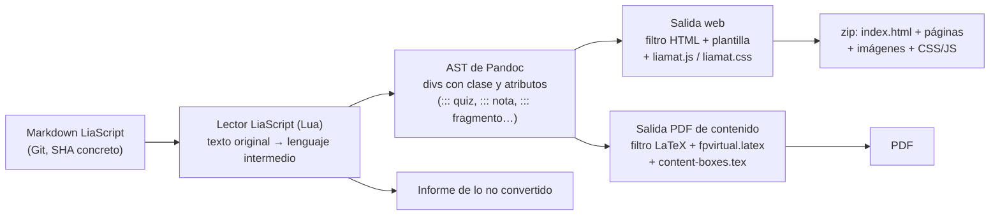

# Roadmap — Generación web estática y PDF de contenido desde LiaScript

**Versión**: 0.2 · **Fecha**: 2026-11-23 · **Estado**: Fase 0 (prototipo)
hecha en la rama `feature/generacion-web` (ver §8)

## 1. Objetivo

Añadir dos formatos de publicación generados desde el mismo Markdown
LiaScript de Git:

- **Web**: un sitio estático de varias páginas (HTML + CSS + JavaScript
  plano, sin compilación), con quizzes y otros elementos interactivos
  funcionando sin el runtime de LiaScript. Se publica en Moodle como recurso
  «Archivo» con `index.html` como fichero principal.
- **PDF de contenido**: un documento solo con el contenido, sin quizzes ni
  estructuras dinámicas, con la plantilla FP Virtual de los PDF actuales.

Los dos se generan con **Pandoc** y una extensión propia (lector LiaScript,
filtros y plantillas), en la línea de lo que ya se hace con las cajas en
`fpvirtual-markdown-a-pdf` (`::: nota` → `pandoc-latex-environment` →
`content-boxes.tex`).

## 2. Contexto y motivos

**Formato actual en producción.** Los materiales HTML de los cursos
(`curso2526.fpvirtualaragon.es`) son sitios exportados con **eXeLearning
2.9**: una página HTML por apartado, navegación entre ellas, CSS propio
(`base.css`, `content.css`, `nav.css`) y JavaScript plano (jQuery,
`common.js`). Un recurso típico ocupa unos 2,8 MB en 114 ficheros, y
`local_educaaragon` lo publica como `mod_resource` con `index.html` como
fichero principal (`sortorder=1`) en ventana emergente de 1200×600. El
alumnado ya conoce esta forma de ver los materiales.

**Por qué no basta con lo que hay:**

| Opción | Problema |
| --- | --- |
| liaex `web` | Es una aplicación, no páginas: 24 MB y 460 ficheros por material (con `ut05`), y renderiza en el navegador |
| liaex `pdf` | Incluye quizzes y el aspecto de LiaScript, no el de los PDF de FP Virtual |
| Pandoc tal cual | No entiende LiaScript: los quizzes salen en bruto (`[( )] …`), las marcas `{{1}}` y `--{{0}}--` se ven, `****` se convierte en separadores y las macros no se expanden |
| Nuxt Content | Tampoco entiende LiaScript (habría que escribir el mismo conversor como plugin de remark), genera rutas absolutas (`/_nuxt/…`) que chocan con `pluginfile.php`, y tarda decenas de segundos por material |

**Prueba previa (`ut05`):** `pandoc -t chunkedhtml` genera 10 páginas y
100 KB en 0,9 s con la imagen `fpvirtual-pandoc` (Pandoc 3.9), que ya
existe. Falta lo que este roadmap describe: entender LiaScript.

## 3. Arquitectura

### 3.1 Lector LiaScript

Es un **lector** de Pandoc en Lua, no un filtro. Pandoc parsea el Markdown
antes de que actúen los filtros, y ese parseo estropea parte de la sintaxis
de LiaScript: los quizzes indentados se convierten en código, `****` en
separadores y las comas de los parámetros de las macros se pierden. El lector
recibe el **texto original**, convierte las construcciones de LiaScript al
lenguaje intermedio y después delega en el lector Markdown normal de Pandoc.

Hace también:

- **Cabecera**: el comentario `<!-- … -->` inicial pasa a metadatos
  (título, autor, idioma, versión) y a una tabla de macros.
- **Expansión de macros** propias de la cabecera (`@nota`, `@aviso`,
  `@error` y cualquier otra con parámetros `@0`…`@9` y bloques
  `@macro … @end`). Las de plantillas importadas (`import:`, p. ej.
  Pyodide) no se expanden: se avisan en el informe.
- **Informe de lo no convertido**: toda construcción LiaScript que no
  reconozca se lista (fichero, línea, tipo), nunca se pierde en silencio.

### 3.2 Lenguaje intermedio

Es el contrato entre el lector y las salidas. Se usan los divs y spans con
clase y atributos de Pandoc (la misma idea que los componentes de
Comark/MDC en Nuxt):

| LiaScript | Lenguaje intermedio |
| --- | --- |
| `[( )] …` / `[(X)] …` | `::: {.quiz tipo="single"}` con las opciones (`.opcion`, `correcta="true"`) |
| `[[ ]] …` / `[[X]] …` | `.quiz tipo="multiple"` |
| `[[respuesta]]` | `.quiz tipo="text"` con `respuesta="…"` |
| `[[a \| (b) \| c]]` en línea | `[…]{.quiz-select}` (span) con las opciones |
| `[[Sí] (No)]` + filas | `.quiz tipo="matrix"` |
| `[[?]] pista` | `::: pista` dentro del quiz |
| Bloque `****` tras un quiz | `::: solucion` dentro del quiz |
| `[(1)]`, `[[1]]`, `[[___]]` (encuestas) | `.encuesta tipo="single|multiple|text"` |
| `@nota(…)`, `@aviso(…)`, `@error(…)` | `::: nota`, `::: aviso`, `::: error` (mismas clases que `content-boxes`) |
| `{{n}}` + bloque `****`, `{n}{texto}` | `::: {.fragmento paso="n"}` / `[…]{.fragmento paso="n"}` |
| `--{{n}}--` (narración) | `::: {.narracion paso="n"}` |
| `
`/acordeones | `::: {.acordeon titulo="…"}` |
| `!?[título](url)` | `::: {.video src="…" titulo="…"}` |
| `?[título](url)` | `::: {.audio src="…"}` |
| `??[título](url)` | `::: {.embed src="…"}` |
| Código con ``, `@LIA.eval`, `@Pyodide.eval` | Bloque de código con `.ejecutable` |
| `<!-- data-type="barchart" … -->` + tabla | Tabla con `.grafico` |
| `<!-- style="…" -->` tras un elemento | Atributos del elemento (si son seguros) o aviso |

### 3.3 Salida web

- **Páginas**: una por sección (`chunkedhtml` o división propia por `#`/`##`),
  `index.html` de entrada, enlaces relativos y navegación lateral entre
  secciones (como eXeLearning). Las imágenes del material se copian al
  paquete conservando su ruta relativa.
- **Comportamiento**: `liamat.js` y `liamat.css`, sin dependencias ni
  compilación. Elementos propios (`<lia-quiz>`, `<lia-fragment>`…) con
  **mejora progresiva**: sin JavaScript se ve todo el contenido y la
  solución en un desplegable.
- **Accesibilidad**: navegación por teclado, ARIA en quizzes y acordeones,
  contraste AA del tema.

### 3.4 Salida PDF de contenido

**Regla: solo contenido.** El PDF no lleva quizzes ni estructuras que se
muevan.

| Elemento | En el PDF |
| --- | --- |
| Prosa, títulos, listas, tablas, código, fórmulas, imágenes, notas al pie | Normal |
| Cajas `nota` / `aviso` / `error` | Con `content-boxes.tex` (tcolorbox), como en los PDF actuales |
| Quizzes y encuestas (con sus pistas y soluciones) | **Se omiten** |
| Fragmentos animados `{{n}}` | Se muestra su contenido, sin animación |
| Acordeones y pestañas | Se muestra su contenido completo, sin el mecanismo |
| Narración | Se omite |
| Vídeo, audio y embebidos | Una línea con el título y el enlace |
| Código ejecutable | Como código normal |
| Gráficos de tablas | La tabla |

Plantilla `fpvirtual.latex` y `content-boxes.tex` de
`fpvirtual-markdown-a-pdf`: el PDF de contenido se ve igual que los PDF de
FP Virtual de hoy.

## 4. Publicación en Moodle

- **Web**: `mod_resource` con todos los ficheros del paquete en
  `mod_resource/content` (conservando carpetas), `index.html` como fichero
  principal (`sortorder=1`) y la visualización elegida (ver §7). Registro
  curso ↔ fichero ↔ SHA ↔ cmid en `local_liamateriales_deploy`, como los
  demás formatos. «Descargar sin publicar» entrega el zip.
- **PDF de contenido**: `mod_resource` con el PDF, como el PDF actual.
- **No se usa `local_educaaragon`**: escribir en su carpeta de origen crearía
  una segunda fuente de verdad (su tarea programada reprocesa la carpeta y
  oculta el módulo anterior). El resultado para el alumnado es el mismo
  (recurso «Archivo» con `index.html`).
- **Avisos**: el informe de lo no convertido se muestra en el diálogo de
  progreso al publicar y en «Descargar sin publicar».

## 5. Fases

### Fase 0 — Prototipo (go/no-go)

1. Lector LiaScript mínimo: cabecera y macros propias, quizzes de opción
   única y múltiple, cajas, fragmentos, narración y vídeo.
2. Salida web con plantilla básica y `liamat.js` para esos quizzes.
3. Salida PDF de contenido con `fpvirtual.latex`.
4. Probado con `ut05-sesiones` y `demo-liascript`: capturas, informe de lo no
   convertido y comparación con liaex.

**Criterio de salida**: los quizzes detectados por el lector coinciden en
número y tipo, sección a sección, con la huella `liaex -f fullJson` de los
dos materiales; la web funciona dentro de `mod_resource` en el Moodle de
pruebas; el PDF no contiene ningún quiz ni marca de LiaScript.

### Fase 1 — Lector completo y lenguaje intermedio

- Todos los elementos de la tabla de §3.2, macros con bloques
  `@macro … @end` y parámetros entre comillas invertidas.
- Especificación del lenguaje intermedio (documento propio en esta carpeta).
- Tests:
  - **Conformidad con liaex** sobre todo el corpus (`contenidos-test` y los
    casos del editor): mismas secciones y mismos quizzes por tipo.
  - Informe de lo no convertido vacío en los materiales reales.
  - Ningún resto de sintaxis LiaScript (`[[`, `{{`, `--{{`, `@macro`) en la
    salida.

**Criterio de salida**: corpus completo convertido sin avisos y con
conformidad 100 %.

### Fase 2 — Salida web

- Plantilla de sitio con navegación lateral, cabecera con logo y título, y
  tema (ver §7).
- `liamat.js`: quizzes (todos los tipos, pistas, solución, comprobar),
  fragmentos (mostrar paso a paso o todo), acordeones, vídeo/audio/embebidos.
- Copia de imágenes y recursos referenciados; enlaces internos entre
  secciones.
- Accesibilidad (teclado, ARIA) y prueba en Chrome (como el e2e del editor).

**Criterio de salida**: los materiales del corpus se navegan y sus quizzes
se resuelven en Chrome sin errores de consola; peso del paquete del orden
de los de eXeLearning.

### Fase 3 — Salida PDF de contenido

- Filtro LaTeX que aplica la tabla de §3.4.
- Integración de `fpvirtual.latex` y `content-boxes.tex` (mismo origen que
  `fpvirtual-markdown-a-pdf`, sin copias divergentes).

**Criterio de salida**: PDF del corpus sin quizzes, encuestas ni marcas de
LiaScript, con las cajas y la portada de FP Virtual.

### Fase 4 — Integración en engine y plugin

- **Engine**: formatos nuevos `web` y `pdf-contenido` en `POST /publish`,
  ejecutando Pandoc en Docker (imagen `fpvirtual-pandoc` con la extensión)
  sobre la copia temporal del SHA. El informe de avisos se devuelve en la
  respuesta (p. ej. cabecera `X-Liamat-Avisos`).
- **Plugin**: `publisher` admite `web` (`mod_resource` con todos los
  ficheros, fichero principal y visualización) y `pdf-contenido`; página
  Publicar y botón del editor con los nuevos formatos; avisos en el diálogo
  de progreso.
- **Editor**: opciones nuevas en el desplegable de Publicar.

**Criterio de salida**: publicar `web` y `pdf-contenido` desde el editor y
desde la página Publicar en el Moodle de pruebas, con registro de SHA y
«Descargar sin publicar».

### Fase 5 — Producción

- Despliegue de la imagen de Pandoc con la extensión junto al engine.
- Medición de tiempos y tamaños con temas largos.
- Guía de autor: qué se ve en la web y qué en el PDF de contenido; qué
  construcciones de LiaScript no se convierten.
- Decidir el papel de los formatos de liaex (`pdf`, `epub`) una vez
  disponibles los nuevos.

## 6. Riesgos

| Riesgo | Mitigación |
| --- | --- |
| El lector malinterpreta sintaxis LiaScript | Prueba de conformidad contra `liaex -f fullJson` en todo el corpus; informe de lo no convertido |
| Divergencia con el clasificador del editor (que decide qué bloques se protegen) | Mismo corpus de pruebas en los dos repos y lista común de construcciones |
| Macros de plantillas importadas no expandibles | Aviso en el informe; tratar caso a caso las plantillas que se usen de verdad |
| Mantenimiento de `liamat.js` | Sin dependencias, alcance acotado a §3.2 y pruebas en navegador |
| Enlaces y recursos dentro de `pluginfile.php` | Solo rutas relativas; prueba en el Moodle de pruebas desde la Fase 0 |
| Dos versiones de la plantilla FP Virtual | La extensión usa la de `fpvirtual-markdown-a-pdf` como origen único |

## 7. Decisiones pendientes

1. **Aspecto de la web**: tema verde del editor (como el resto de formatos)
   o marca FP Virtual de los PDF.
2. **Visualización en Moodle**: ventana emergente de 1200×600 como los
   recursos de eXeLearning, o «Abrir» en la propia ventana.
3. **Formatos de liaex** (`pdf`, `epub`): mantenerlos junto a los nuevos o
   retirarlos cuando la web y el PDF de contenido estén en producción.

## 8. Estado — Fase 0 (prototipo)

Rama `feature/generacion-web`. Código en
`engine/src/materiales_liascript/publish/`:

| Pieza | Fichero |
| --- | --- |
| Lector LiaScript | `pandoc/liascript.lua` |
| Filtro web | `pandoc/web.lua` |
| Filtro PDF de contenido | `pandoc/contenido.lua` |
| Plantilla web | `pandoc/web.html` |
| Comportamiento y estilo de la web | `pandoc/assets/liamat.js`, `pandoc/assets/liamat.css` |
| Ejecución en Docker (web en zip y PDF) | `pandoc_export.py` (`PandocExporter`) |

**Resultados con el corpus** (`ut03-mvc`, `ut04-pdo`, `ut05-sesiones`,
`demo-liascript`):

- **Conformidad con LiaScript: 4/4.** Mismas secciones y mismos quizzes por
  tipo que `liaex -f fullJson` (`tests/test_pandoc_export.py`).
- **Web**: `ut05` en 17 KB comprimida (12 ficheros) en 0,6 s; la demo en
  31 KB. Sin restos de sintaxis LiaScript, nombres de página ASCII y sin
  avisos del lector.
- **Comportamiento en Chrome: 12/12** (`tests/web/liamat_e2e.mjs`): opción
  única y múltiple, selección en línea, matriz y texto, con pistas, «Ver
  respuesta» y solución; encuesta sin guardar; índice con la página actual;
  sin errores de JavaScript.
- **PDF de contenido**: `ut05` en 37 KB en 5 s, con la plantilla FP Virtual.
  Sin quizzes, encuestas ni sus enunciados; las secciones que solo tenían
  preguntas («Autoevaluación», «Tu opinión») desaparecen.

**Decisiones tomadas en el prototipo** (revisables):

- La web usa el **tema verde** del editor (decisión pendiente nº 1).
- En el PDF, el **enunciado** de cada quiz (el párrafo inmediatamente
  anterior) se omite con el quiz, y los párrafos con selección en línea se
  omiten enteros; los títulos que se quedan sin contenido desaparecen.
- La caja `error` se dibuja como `importante` en el PDF (`content-boxes.tex`
  solo define `nota`, `aviso` e `importante`).
- Atributo `tipo` (no `type`) en el lenguaje intermedio: Pandoc no prefija
  con `data-` los atributos HTML válidos como `type`.

**Pendiente del criterio de salida**: comprobar la web dentro de
`mod_resource` en el Moodle de pruebas (requiere la Fase 4 o subirla a mano).

## 9. Estado — Fase 4 (integración)

Rama `feature/generacion-web` en este repo y en `fpvirtual-crepe-editor`.

- **Engine**: `POST /publish` con `format: "web"` (zip con `index.html` en la
  raíz) y `format: "pdfcontenido"`. El formato se llama `pdfcontenido` (sin
  guion: el plugin valida los tipos con `PARAM_ALPHANUM`). Avisos del lector
  en la cabecera `X-Liamat-Avisos`. Imagen `pandoc/extra:latest` (pública;
  ya trae XeLaTeX y `pandoc-latex-environment`), configurable con
  `MATERIALES_LIASCRIPT_PANDOC_IMAGE`; la plantilla FP Virtual va incluida
  (`pandoc/fpvirtual-theme/`), así que no hace falta construir
  `fpvirtual-pandoc`.
- **Plugin 2.5.0**: web como recurso «Archivo» con todos sus ficheros e
  `index.html` como principal; visualización configurable en los ajustes
  del plugin (por defecto ventana emergente de 1200×600, decisión pendiente
  nº 2). Avisos en la actividad publicada, en «Descargar sin publicar» y en
  `publish_api.php`.
- **Editor**: los dos formatos en el desplegable de Publicar; avisos en el
  banner.

**Pendiente del criterio de salida**: publicar y descargar los dos formatos
en el Moodle de pruebas, desde la página Publicar y desde el editor.
