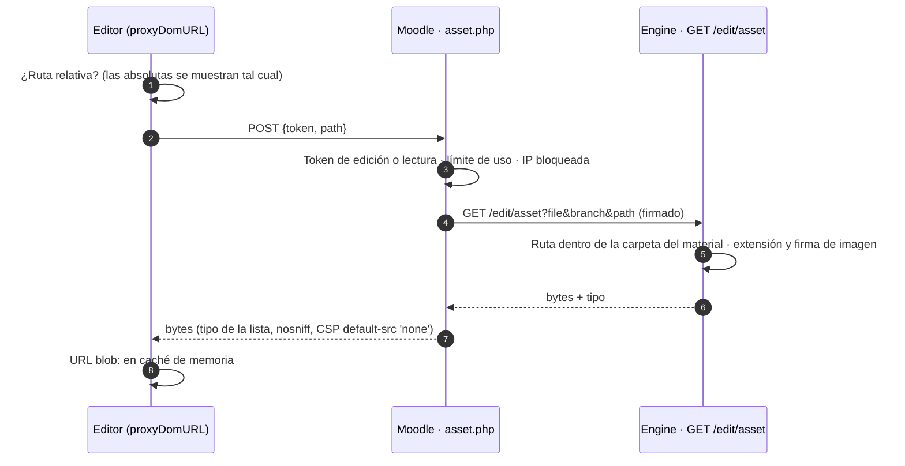

# Roadmap — Imágenes en los materiales

Ver y subir imágenes desde el editor, con Git como fuente de verdad.

Rama `feature/imagenes` (sale de `feature/seguridad`) en este repositorio y
en `fpvirtual-crepe-editor`. **Fusionada en `main` en los dos repositorios
(2026-11-26)** y desplegada desde `main` en el servidor de pruebas (§7).

## 1. Objetivo

- **Ver** en el editor las imágenes que el material referencia con rutas
  relativas (``). Hoy dan 404: el navegador las
  resuelve contra el origen del editor.
- **Subir** imágenes desde el editor (botón de Crepe) sin servicios
  externos: quedan en el repositorio de contenidos, junto al material, y
  funcionan igual en LiaScript, liaex, Pandoc y la web estática.

## 2. Decisiones

| # | Decisión | Motivo |
| --- | --- | --- |
| D1 | Las imágenes viven en Git, en `<carpeta del material>/img/`, con rutas relativas en el Markdown | Git es la fuente de verdad; las exportaciones ya trabajan sobre una copia del commit |
| D2 | **Opción B**: las imágenes subidas quedan pendientes en el editor y viajan con el guardado; el engine hace **un único commit** con el Markdown y sus imágenes | Atomicidad, sin imágenes huérfanas, mismo control de concurrencia por SHA (409) |
| D3 | El editor pide los bytes por `POST` (token en el cuerpo) y los muestra como `blob:` (`proxyDomURL` de Crepe) | Ningún token en las URL (LIA-062) |
| D4 | Subida: PNG, JPEG y GIF. Lectura: además WebP (materiales existentes). **SVG excluido** | Un SVG puede llevar JavaScript y se publicaría en el dominio de Moodle (riesgo R5). WebP no se sube: el H5P de liaex la descarta (§2.1) |
| D5 | El navegador redimensiona (máx. 1920 px) y recodifica a **JPEG** (fotos) o **PNG** (con transparencia); GIF sin tocar | Menos peso en Git; la recodificación elimina el EXIF (privacidad, GPS); JPEG y PNG funcionan en todos los formatos |
| D6 | Nombre: `img/<slug>-<hash8>.<ext>` (hash del contenido) | Sin colisiones; la misma imagen dos veces se guarda una vez |
| D7 | Límites: 2 MB por imagen (ya comprimida), 20 imágenes y 10 MB por guardado (constantes iguales en plugin y engine) | Tamaño del repositorio y de las peticiones |
| D8 | El pie del bloque de imagen de Crepe **es** el texto alternativo; el título se conserva | Crepe guardaba la proporción en el texto alternativo (``): perdía el texto alternativo de cualquier material con una imagen sola en su párrafo (corregido en la fase 1) |
| D9 | **Un material por carpeta** en el repositorio de contenidos (`materiales/<material>/<material>.md` + `img/`), y el engine exporta con liaex desde una copia sin los otros `.md` de la carpeta | liaex empaqueta la carpeta del material: el H5P llevaba los demás materiales (§2.1). La copia aislada lo evita aunque un repositorio no siga la convención |
| D11 | Ancho de imagen en % del ancho del texto con el comentario de LiaScript `<!-- style="width: N%;" -->`, de 10 a 100 | Sintaxis documentada de LiaScript; 100 % es el ancho imprimible del PDF; el tirador de alto de Crepe no se guardaba |
| D12 | Columnas con `<div class="lia-columnas">` y `<div class="lia-columna">` con estilo flex | LiaScript no tiene clases de columnas; el estilo del div se aplica a su Markdown (comprobado con liaex). Las clases permiten al editor y a Pandoc reconocerlas |
| D10 | **Sin Git LFS** por ahora | El engine escribe los blobs directamente (`hash-object`, `mktree`); con LFS tendría que escribir punteros y subir los ficheros a un servidor LFS. Con 2 MB por imagen ya comprimida, un curso con cientos de imágenes son decenas o pocos cientos de MB. Revisar si el repositorio de contenidos supera ~1 GB o los clones se vuelven lentos |

### 2.1 Comportamiento de cada formato (fase 0)

Medido con `engine/tests/fixtures/liascript/ut06-imagenes.md`:

| Imagen | Web | PDF de contenido | H5P | SCORM | ePub | PDF de liaex |
| --- | --- | --- | --- | --- | --- | --- |
| PNG, JPEG | ✓ | ✓ | ✓ | ✓ | ✓ (renombradas) | ✓ |
| GIF | ✓ | ✓ con conversión a PNG | ✓ | ✓ | ✓ | ✓ |
| WebP | ✓ | ✓ con conversión a PNG | **✗ no la incluye** | ✓ | ✓ | ✓ |
| Externa (https) | ✓ (enlace) | ✗ sin red: texto alternativo | — | — | ✗ sin red | — |

- XeLaTeX no admite WebP ni GIF: el engine crea una copia PNG con Pillow
  (`images.png_copies_for_pdf`) y `contenido.lua` la usa.
- El H5P de liaex descarta las WebP (por extensión). Por eso el editor no
  sube WebP (D4, D5); las que ya existan en un material no salen en el H5P.
- **Hallazgo aparte**: el H5P de liaex mete en el paquete **todos los `.md`
  de la carpeta del material**, es decir, otros materiales. Se descargaban
  con el paquete. Resuelto en la fase 3 (D9): `contenidos-test` pasa a un
  material por carpeta y el engine exporta desde una copia aislada
  (`publish.service.isolate_material`).

Descartado: guardar las imágenes en Moodle (rompe D1; liaex y Pandoc no
podrían leerlas) y un commit por imagen al subirla (opción A: huérfanas y
conflictos al mover el HEAD).

## 3. Arquitectura

### 3.1 Ver (fase 1)



### 3.2 Subir (fase 2)

```mermaid
sequenceDiagram
  autonumber
  actor P as Profesor
  participant ED as Editor
  participant S as Moodle · save.php
  participant E as Engine · POST /edit/save

  P->>ED: Sube una imagen (botón de Crepe)
  ED->>ED: Redimensiona y recodifica · hash · img/slug-hash.ext
  ED->>ED: Pendiente (memoria + borrador IndexedDB) · se ve como blob:
  P->>ED: Guardar
  ED->>S: {file, branch, original_sha, content, token, images: [{path, content_base64}]} (solo las referenciadas)
  S->>S: Límites (número, tamaño) · tipo real (finfo, getimagesize) · ruta y extensión
  S->>E: Mismo cuerpo (firmado)
  E->>E: Validación (ruta, extensión, firma de bytes, tamaño)
  E->>E: Un commit: Markdown + imágenes (CAS sobre original_sha; si no, rama de resolución)
  E-->>S: 200 {new_sha} o 409
  S-->>ED: 200 {new_sha, token} → las pendientes pasan a guardadas
```

## 4. Fases

### Fase 0 — Corpus con imágenes

- Material de prueba con imágenes relativas (en `img/` y junto al `.md`) y
  absolutas en los tests del engine.
- Comprobar las exportaciones (web, PDF de contenido; H5P, SCORM, ePub y
  PDF de liaex).

### Fase 1 — Ver las imágenes del repositorio

- **Engine**: `GitProvider.get_bytes`; `EditService.asset(file, branch,
  path)` con la ruta resuelta respecto al `.md`, dentro de su carpeta, con
  extensión y firma de imagen comprobadas; `GET /edit/asset`.
- **Plugin**: `asset.php` (token en el cuerpo, también de solo lectura;
  límite `asset`; cabeceras de la fase S); `asset_endpoint` en el bloque
  `liascript-lms`.
- **Editor**: `proxyDomURL` con caché de `blob:`; el puente se crea antes de
  montar el editor.
- **Despliegue**: `blob:` en `img-src` de la CSP del editor.

**Criterio de salida**: un material con imágenes relativas se ve en el
editor; ninguna URL lleva token; rutas fuera de la carpeta del material →
404.

### Fase 2 — Subir imágenes

- **Editor**: `onUpload` (redimensionar, recodificar, hash, nombre),
  imágenes pendientes (memoria y borrador), `images` en el guardado (solo
  las referenciadas), las pendientes pasan a la caché al guardar.
- **Plugin**: `save.php` valida y reenvía `images`; ajustes de límites;
  evento `material_saved` con el número de imágenes.
- **Engine**: `GitProvider.commit_files` (varios ficheros, texto y binario,
  un commit con CAS); `SaveRequest.images`; validación; también en la rama
  de resolución del 409.

**Criterio de salida**: subir, ver, guardar y recargar; el commit contiene
Markdown e imágenes; el borrador recupera las imágenes; el 409 conserva las
imágenes en la rama de resolución; e2e del editor.

### Fase 3 — Pegar, texto alternativo y paquetes aislados

- **Editor**: pegar y arrastrar con un uploader propio para el plugin de
  subida de Milkdown (`src/editor/imagePaste.ts`). El de Crepe dejaba el
  marcador «Upload in progress...» para siempre si una imagen fallaba y
  perdía todo el pegado; el propio prepara una a una, salta las no
  admitidas con aviso y nunca rechaza.
- **Editor**: aviso (no bloquea) si el material guardado tiene imágenes sin
  texto alternativo (`missingAlt`; fuera del código; un bloque vacío no
  cuenta).
- **Engine**: `isolate_material` quita de la copia temporal del SHA los
  otros `.md` de la carpeta antes de llamar a liaex (conserva los que el
  material referencia: plantillas locales en `import:`, enlaces).
- **Contenidos**: `contenidos-test` en un material por carpeta, con
  imágenes de prueba (PNG con y sin transparencia, JPEG con título, GIF
  animado en línea).
- **Git LFS**: descartado por ahora (D10).

**Comprobado** con liaex y Pandoc reales sobre `contenidos-test`: el H5P y
el SCORM de `ut05-sesiones` y de `demo-liascript` llevan solo su `.md` y sus
imágenes; la web y el PDF de contenido incluyen las imágenes.

### Fase 4 — Borrado, tamaño y columnas

- **Borrado** (engine): el guardado borra, en el mismo commit, las imágenes
  que el material usaba en `original_sha` y ya no usa, si ningún otro `.md`
  del repositorio las referencia (también con `../`). Nunca las que el
  material no referenciaba. `commit_files` acepta `None` (borrar).
  Detectado en LIA-124: tres imágenes huérfanas en la rama de ut03.
- **Borrado** (editor): borrar una imagen sola en su párrafo **nunca se
  guardaba**. El bloque de imagen de Crepe no tenía posición y el
  preservador de la fuente la recuperaba del hueco original. Si se deshace
  un borrado ya guardado, el editor reenvía la imagen.
- **Ancho** (D11): `<!-- style="width: 40%;" -->`, la
  sintaxis documentada de LiaScript. En el editor, barra *Ancho* (10–100 %
  del ancho del texto o de la columna; 100 % = ancho imprimible del PDF).
  En Pandoc, atributo `width` (web: `width: 40%`; PDF: `0.4\linewidth`).
- **Columnas** (D12): LiaScript no tiene clases de columnas, pero aplica el
  estilo de un `<div>` al Markdown que contiene. Formato:
  `<div class="lia-columnas" style="display: flex; …">` con
  `<div class="lia-columna" style="flex: 1 1 14em; min-width: 0;">` y
  líneas en blanco alrededor del Markdown. Comprobado con liaex (web en
  Chrome): texto e imagen y dos imágenes lado a lado. En el PDF de
  contenido, una minipage por columna. En el editor, columnas editables
  (no HTML protegido); plantillas *Dos columnas*, *Texto e imagen* y *Dos
  imágenes lado a lado*.

## 5. Seguridad

- Rutas: relativas, normalizadas, dentro de la carpeta del material, sin
  `..`, solo `[A-Za-z0-9._/-]`, extensión permitida.
- Contenido: tipo real en el plugin (`finfo`, `getimagesize`) y firma de los
  primeros bytes en el engine; el tipo devuelto al navegador sale de la
  lista, nunca del cliente.
- `asset.php`: `X-Content-Type-Options: nosniff`, `Content-Security-Policy:
  default-src 'none'`, sin caché compartida, límites de uso y bloqueo por
  IP como el resto de scripts del editor.
- Sin SVG (D4). EXIF eliminado al recodificar (D5).
- Documento de seguridad: añadir `asset.php` y el guardado con imágenes.

## 6. Estado

| Fase | Estado |
| --- | --- |
| 0 — Corpus | Hecha: material de prueba, matriz por formato, conversión a PNG en el PDF de contenido |
| 1 — Ver | Hecha: `GET /edit/asset`, `asset.php`, `ImageStore` en el editor. Corregida la pérdida del texto alternativo en el bloque de imagen de Crepe |
| 2 — Subir | Hecha: `commit_files` y `images` en el guardado (engine), validación en `save.php`, subida en el editor (reducir, recodificar, pendientes, borrador) |
| 3 — Pegar y aislar | Hecha: pegar y arrastrar, aviso de texto alternativo, paquetes de liaex sin otros materiales, un material por carpeta en `contenidos-test`. Git LFS descartado por ahora (D10) |
| Prueba en Moodle | Hecha (LIA-124, §7): las nueve comprobaciones pasan en el servidor de pruebas con Chrome real. Reveló las imágenes huérfanas y tres fallos, corregidos |
| 4 — Borrado, tamaño y columnas | Hecha: borrado en Git y en el editor, ancho de imagen, dos columnas (editor, web y PDF de contenido) |

## 7. Prueba en el servidor de pruebas (LIA-124, 2026-11-25)

Servidor 192.168.2.253: Moodle 8088 (plugin montado desde el clon), engine
8091 (solo en la red interna) y editor 8092 (estático, **por http**). Se
desplegó primero la fase S (secreto compartido en `.env` y `config.php`,
puerto del engine sin publicar), que `feature/imagenes` incluye. Pruebas del
editor con Chrome real (headless, el de la imagen `liascript/exporter`) como
`profesor.cac` en CAC-TEST.

| Comprobación | Resultado |
| --- | --- |
| a) Catálogo | Los cinco materiales con las rutas nuevas; las publicaciones antiguas con rutas viejas siguen en el historial |
| b) Ver | Imágenes con POST a `asset.php`, ninguna URL con token, GIF en línea; sin violaciones de la CSP |
| c) Subir | JPEG de 3000×2000 → 1920×1280; aviso de texto alternativo; el pie se conserva al recargar |
| d) Pegar y arrastrar | Entran las dos, sin «Preparando la imagen…»; SVG rechazado con aviso |
| e) Git | Un commit por guardado con el `.md` y `img/<nombre>-<hash>`; lado mayor ≤ 1920 px, sin EXIF |
| f) Conflicto | Diálogo de conflicto; la rama `resolucion/*` contiene la imagen |
| g) Publicar | Seis formatos de `ut05-sesiones` y `demo-liascript` con imágenes; H5P y SCORM solo con su `.md` |
| h) Seguridad | `../`, rutas absolutas, otro material, `.git` y el propio `.md` → 404; token falso → 403 |
| i) Registros | «Material guardado» con el número de imágenes; evento de conflicto |

**Fallos encontrados y corregidos**:

1. **Editor servido por http: ninguna imagen se podía subir** («No se pudo
   leer la imagen» con cualquier PNG o JPEG). El nombre usa SHA-256 con
   `crypto.subtle`, que solo existe en contextos seguros. Respaldo en
   JavaScript (`src/lms/sha256.ts`) que da el mismo nombre con o sin HTTPS.
2. **Engine bloqueado al abrir un material con varias imágenes.** El editor
   pide todas a la vez; las lecturas paralelas compartían el `git cat-file
   --batch` de GitPython, se mezclaban («SHA … could not be resolved», ramas
   «no encontradas», un PNG que «no es image/png») y los hilos del pool
   quedaban bloqueados: el engine solo respondía a `/health`. Las lecturas
   con GitPython van bajo un `RLock` en `LocalGitProvider`; test con 16
   hilos (sin el bloqueo se cuelga).
3. **«No se pudo completar: HTTP 200» al publicar por primera vez un PDF,
   PDF de contenido o ePub**: sin `display`, `resource_add_instance()`
   avisaba en mitad de la respuesta JSON. Se usan los valores por defecto
   de Recurso del sitio (`publisher::resource_defaults()`).

**Notas del despliegue**: PHPUnit no está instalado en ese Moodle (los tests
del plugin no se ejecutaron allí); `display_errors` está activado, así que
cualquier aviso de PHP rompe las respuestas JSON del plugin.

**Pendiente**: el editor guarda `` si un bloque de imagen queda vacío
(en las plantillas de columnas es el hueco de la imagen, a propósito). La web
y el PDF de contenido lo omiten con aviso; falta decidir si el editor debe
quitarlo al guardar o avisar como con el texto alternativo.
