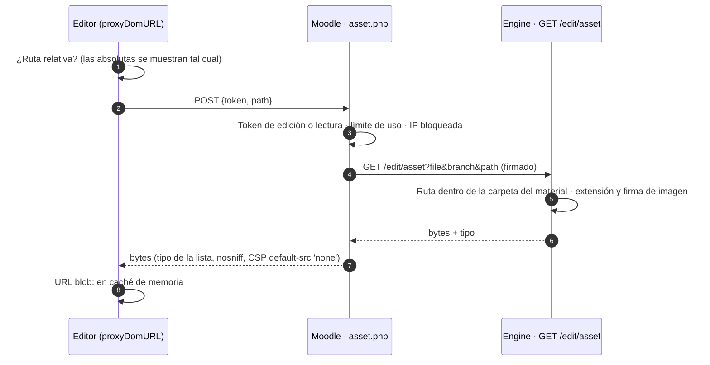

# Roadmap — Imágenes en los materiales

Ver y subir imágenes desde el editor, con Git como fuente de verdad.

Rama `feature/imagenes` (sale de `feature/seguridad`) en este repositorio y
en `fpvirtual-crepe-editor`.

## 1. Objetivo

- **Ver** en el editor las imágenes que el material referencia con rutas
  relativas (``). Hoy dan 404: el navegador las
  resuelve contra el origen del editor.
- **Subir** imágenes desde el editor (botón de Crepe) sin servicios
  externos: quedan en el repositorio de contenidos, junto al material, y
  funcionan igual en LiaScript, liaex, Pandoc y la web estática.

## 2. Decisiones

| # | Decisión | Motivo |
| --- | --- | --- |
| D1 | Las imágenes viven en Git, en `<carpeta del material>/img/`, con rutas relativas en el Markdown | Git es la fuente de verdad; las exportaciones ya trabajan sobre una copia del commit |
| D2 | **Opción B**: las imágenes subidas quedan pendientes en el editor y viajan con el guardado; el engine hace **un único commit** con el Markdown y sus imágenes | Atomicidad, sin imágenes huérfanas, mismo control de concurrencia por SHA (409) |
| D3 | El editor pide los bytes por `POST` (token en el cuerpo) y los muestra como `blob:` (`proxyDomURL` de Crepe) | Ningún token en las URL (LIA-062) |
| D4 | Subida: PNG, JPEG y GIF. Lectura: además WebP (materiales existentes). **SVG excluido** | Un SVG puede llevar JavaScript y se publicaría en el dominio de Moodle (riesgo R5). WebP no se sube: el H5P de liaex la descarta (§2.1) |
| D5 | El navegador redimensiona (máx. 1920 px) y recodifica a **JPEG** (fotos) o **PNG** (con transparencia); GIF sin tocar | Menos peso en Git; la recodificación elimina el EXIF (privacidad, GPS); JPEG y PNG funcionan en todos los formatos |
| D6 | Nombre: `img/<slug>-<hash8>.<ext>` (hash del contenido) | Sin colisiones; la misma imagen dos veces se guarda una vez |
| D7 | Límites: 2 MB por imagen (ya comprimida), 20 imágenes y 10 MB por guardado (constantes iguales en plugin y engine) | Tamaño del repositorio y de las peticiones |
| D8 | El pie del bloque de imagen de Crepe **es** el texto alternativo; el título se conserva | Crepe guardaba la proporción en el texto alternativo (``): perdía el texto alternativo de cualquier material con una imagen sola en su párrafo (corregido en la fase 1) |

### 2.1 Comportamiento de cada formato (fase 0)

Medido con `engine/tests/fixtures/liascript/ut06-imagenes.md`:

| Imagen | Web | PDF de contenido | H5P | SCORM | ePub | PDF de liaex |
| --- | --- | --- | --- | --- | --- | --- |
| PNG, JPEG | ✓ | ✓ | ✓ | ✓ | ✓ (renombradas) | ✓ |
| GIF | ✓ | ✓ con conversión a PNG | ✓ | ✓ | ✓ | ✓ |
| WebP | ✓ | ✓ con conversión a PNG | **✗ no la incluye** | ✓ | ✓ | ✓ |
| Externa (https) | ✓ (enlace) | ✗ sin red: texto alternativo | — | — | ✗ sin red | — |

- XeLaTeX no admite WebP ni GIF: el engine crea una copia PNG con Pillow
  (`images.png_copies_for_pdf`) y `contenido.lua` la usa.
- El H5P de liaex descarta las WebP (por extensión). Por eso el editor no
  sube WebP (D4, D5); las que ya existan en un material no salen en el H5P.
- **Hallazgo aparte**: el H5P de liaex mete en el paquete **todos los `.md`
  de la carpeta del material**, es decir, otros materiales. Se descargan con
  el paquete. Conviene un material por carpeta o que el engine exporte desde
  una copia que solo contenga el material y sus recursos (pendiente).

Descartado: guardar las imágenes en Moodle (rompe D1; liaex y Pandoc no
podrían leerlas) y un commit por imagen al subirla (opción A: huérfanas y
conflictos al mover el HEAD).

## 3. Arquitectura

### 3.1 Ver (fase 1)



### 3.2 Subir (fase 2)

```mermaid
sequenceDiagram
  autonumber
  actor P as Profesor
  participant ED as Editor
  participant S as Moodle · save.php
  participant E as Engine · POST /edit/save

  P->>ED: Sube una imagen (botón de Crepe)
  ED->>ED: Redimensiona y recodifica · hash · img/slug-hash.ext
  ED->>ED: Pendiente (memoria + borrador IndexedDB) · se ve como blob:
  P->>ED: Guardar
  ED->>S: {file, branch, original_sha, content, token, images: [{path, content_base64}]} (solo las referenciadas)
  S->>S: Límites (número, tamaño) · tipo real (finfo, getimagesize) · ruta y extensión
  S->>E: Mismo cuerpo (firmado)
  E->>E: Validación (ruta, extensión, firma de bytes, tamaño)
  E->>E: Un commit: Markdown + imágenes (CAS sobre original_sha; si no, rama de resolución)
  E-->>S: 200 {new_sha} o 409
  S-->>ED: 200 {new_sha, token} → las pendientes pasan a guardadas
```

## 4. Fases

### Fase 0 — Corpus con imágenes

- Material de prueba con imágenes relativas (en `img/` y junto al `.md`) y
  absolutas en los tests del engine.
- Comprobar las exportaciones (web, PDF de contenido; H5P, SCORM, ePub y
  PDF de liaex).

### Fase 1 — Ver las imágenes del repositorio

- **Engine**: `GitProvider.get_bytes`; `EditService.asset(file, branch,
  path)` con la ruta resuelta respecto al `.md`, dentro de su carpeta, con
  extensión y firma de imagen comprobadas; `GET /edit/asset`.
- **Plugin**: `asset.php` (token en el cuerpo, también de solo lectura;
  límite `asset`; cabeceras de la fase S); `asset_endpoint` en el bloque
  `liascript-lms`.
- **Editor**: `proxyDomURL` con caché de `blob:`; el puente se crea antes de
  montar el editor.
- **Despliegue**: `blob:` en `img-src` de la CSP del editor.

**Criterio de salida**: un material con imágenes relativas se ve en el
editor; ninguna URL lleva token; rutas fuera de la carpeta del material →
404.

### Fase 2 — Subir imágenes

- **Editor**: `onUpload` (redimensionar, recodificar, hash, nombre),
  imágenes pendientes (memoria y borrador), `images` en el guardado (solo
  las referenciadas), las pendientes pasan a la caché al guardar.
- **Plugin**: `save.php` valida y reenvía `images`; ajustes de límites;
  evento `material_saved` con el número de imágenes.
- **Engine**: `GitProvider.commit_files` (varios ficheros, texto y binario,
  un commit con CAS); `SaveRequest.images`; validación; también en la rama
  de resolución del 409.

**Criterio de salida**: subir, ver, guardar y recargar; el commit contiene
Markdown e imágenes; el borrador recupera las imágenes; el 409 conserva las
imágenes en la rama de resolución; e2e del editor.

### Fase 3 — Pendiente después

- Pegar y arrastrar imágenes (plugin de subida de Milkdown).
- Texto alternativo obligatorio o aviso si falta.
- Git LFS si el volumen de imágenes crece.

## 5. Seguridad

- Rutas: relativas, normalizadas, dentro de la carpeta del material, sin
  `..`, solo `[A-Za-z0-9._/-]`, extensión permitida.
- Contenido: tipo real en el plugin (`finfo`, `getimagesize`) y firma de los
  primeros bytes en el engine; el tipo devuelto al navegador sale de la
  lista, nunca del cliente.
- `asset.php`: `X-Content-Type-Options: nosniff`, `Content-Security-Policy:
  default-src 'none'`, sin caché compartida, límites de uso y bloqueo por
  IP como el resto de scripts del editor.
- Sin SVG (D4). EXIF eliminado al recodificar (D5).
- Documento de seguridad: añadir `asset.php` y el guardado con imágenes.

## 6. Estado

| Fase | Estado |
| --- | --- |
| 0 — Corpus | Hecha: material de prueba, matriz por formato, conversión a PNG en el PDF de contenido |
| 1 — Ver | Hecha: `GET /edit/asset`, `asset.php`, `ImageStore` en el editor. Corregida la pérdida del texto alternativo en el bloque de imagen de Crepe |
| 2 — Subir | Hecha: `commit_files` y `images` en el guardado (engine), validación en `save.php`, subida en el editor (reducir, recodificar, pendientes, borrador) |
| 3 — Después | Pendiente: pegar y arrastrar, aviso de texto alternativo vacío, exportar el H5P sin los otros `.md` de la carpeta, Git LFS |
