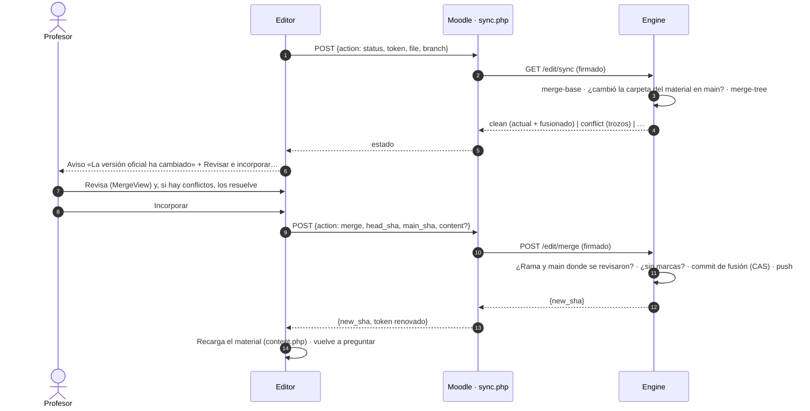

# Incorporar la versión oficial (`main`) a las ramas de edición — LIA-130

La rama `edicion/<usuario>/<material>` se crea desde `main` la primera vez
que el profesor abre el material (D4) y antes nunca se actualizaba: si
coordinación cambiaba `main`, el profesor seguía editando una copia antigua
sin enterarse, y al publicar desde su rama perdía esos cambios.

## 1. Decisiones

| # | Decisión | Motivo |
| --- | --- | --- |
| M1 | El editor **pregunta** al abrir el material y tras cada guardado; nada se incorpora sin que el profesor lo revise y pulse *Incorporar* | Sus cambios y los oficiales conviven en su texto: debe ver el resultado |
| M2 | Solo cuentan los cambios de `main` en la **carpeta del material**; si `main` solo cambió otros materiales, no hay aviso | Lo que se publica es la carpeta del material (mismo criterio que LIA-129) |
| M3 | Fusión en el engine **en memoria** (`git merge-tree --write-tree`, Git ≥ 2.38) y commit de fusión con dos padres (HEAD de la rama y `main`) con compare-and-swap | Sin worktrees ni índice; misma garantía que el guardado (D5) |
| M4 | Conflictos en el material: el editor los resuelve en una vista lado a lado con `@codemirror/merge` (oficial \| resultado editable, flechas para tomar la oficial) | La idea de Meld en el navegador, sin instalar nada |
| M5 | Conflictos fuera del material (otros ficheros) o material retirado de `main`: **coordinación**, con Meld en local (`scripts/incorporar-main.sh`) | Son casos raros y no son del profesor |
| M6 | *Incorporar* exige que la rama y `main` sigan donde se revisaron (si no, 409 y se revisa de nuevo) y el material resuelto sin marcas de conflicto (400) | Nunca se incorpora algo distinto de lo que se vio |
| M7 | Hay que guardar antes de incorporar | La fusión es sobre lo guardado; el editor recarga el material después |

## 2. Estados (`GET /edit/sync`)

| Estado | Cuándo | En el editor |
| --- | --- | --- |
| `up_to_date` | `main` no avanzó, o solo cambió otros materiales | Nada |
| `clean` | Hay cambios del material y no chocan | Aviso, *Revisar e incorporar…*: tu versión \| cómo quedará |
| `conflict` | Tú y `main` cambiasteis las mismas líneas del material | Aviso; vista oficial \| resultado editable con flechas |
| `conflict_other` | Chocan otros ficheros o el material ya no está en `main` | Aviso para coordinación |
| `not_applicable` | La rama es `main` (`editmain`) | Nada |

Los trozos del conflicto salen de `git merge-file --diff3` con marcas de 21
caracteres (`=======` de 7 es un subrayado de título Markdown válido): lo
que solo cambió un lado ya viene fusionado en las partes comunes.

## 3. Flujo



## 4. Seguridad

- `sync.php` sigue el patrón de `save.php`: token de **escritura** del
  fichero y la rama en el cuerpo, CORS limitado al editor, bloqueo por IP,
  límite propio (`ratelimit_sync`, 20/min) y errores genéricos salvo el
  motivo del engine en 409/400 (es para el profesor). Nunca sobre `main`.
- El engine solo fusiona `main` en la rama del token; el commit es de
  fusión (trazable: dos padres) y lleva al profesor como autor.
- Evento `material_saved` con `merged_main` (SHA de `main` incorporado).

## 5. Coordinación con Meld

```bash
# En un clon del repositorio de contenidos, con Meld instalado:
scripts/incorporar-main.sh edicion/ana/materiales-ut03-mvc-ut03-mvc          # revisar
scripts/incorporar-main.sh edicion/ana/materiales-ut03-mvc-ut03-mvc --push   # y subir
```

Lo que no choca se fusiona solo; los conflictos se abren en Meld a tres
paneles. Si la rama local diverge de `origin` (una fusión anterior sin
subir), el script se para y explica cómo seguir.

## 6. Estado

| Parte | Estado |
| --- | --- |
| Engine: `/edit/sync`, `/edit/merge`, `merge_tree`, `commit_merge` | Hecho (9 tests) |
| Plugin 2.11.0: `sync.php`, `sync_endpoint` | Hecho (lint; sin PHPUnit) |
| Editor: aviso, `MergeDialog.vue` con `@codemirror/merge` | Hecho (7 tests, e2e) |
| Script de coordinación con Meld | Hecho (probado con un repositorio de juguete) |
| Prueba en el Moodle de pruebas | Pendiente |
