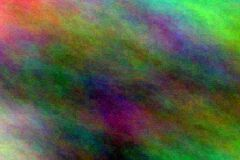

<!--
author: Equipo DWES
language: es
narrator: Spanish Female
comment: Material de prueba con imágenes (roadmap docs/imagenes).
-->

# UT06 — Imágenes en un material

## Imagen en una subcarpeta

El patrón MVC separa el modelo, la vista y el controlador.

## Imagen junto al material

## Imagen en línea y externa

Una foto en línea  dentro de un párrafo.

Una imagen externa: 
